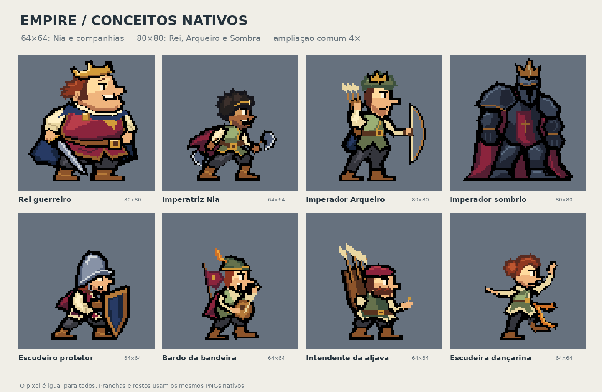

# Empire — conceitos nativos dos imperadores · V6

18/10/2026. **Nova proposta para avaliação do autor.** A pesquisa arquivada e as rejeições anteriores foram lidas antes desta construção. A V6 não muda a situação de aprovação das imagens antigas.



## Abrir primeiro

- [Inspeção interativa, sem ligação à internet](inspecao.html): tamanho real, ampliação inteira, seis expressões, grelha, silhueta, valores e fundos claro/escuro.
- [Rei e escudeiro](previews/01-rei-escudeiro.png).
- [Nia e bardo](previews/02-nia-bardo.png).
- [Arqueiro e intendente](previews/03-arqueiro-intendente.png).
- [Sombra e dançarina](previews/04-sombra-dancarina.png).
- [Repouso e floração](previews/05-sombra-floracao.png).
- [Decisões de desenho, pesquisa aplicada e limites](DIRECAO-APLICADA.md).

## Tamanhos efetivos

| Grelha do PNG | Personagens |
| --- | --- |
| 64×64 | Nia, escudeiro, bardo, intendente e dançarina |
| 80×80 | Rei, Imperador Arqueiro e imperador sombrio |
| 80×80 | Pose sentada do imperador sombrio |
| 128×24 | Cada camada de vegetação, independente do corpo |

O quadro 80×80 é a proposta V6 para “um pouco maior”: mais 16 células em cada eixo. Não altera a escala de um pixel nem redefine os perfis do runtime.

Os corpos foram construídos por grupos de cor com coordenadas inteiras **já na dimensão final**. Nenhuma ilustração foi reduzida, quantizada ou amostrada para obter estes PNGs. As pranchas ampliam os ficheiros pequenos por nearest neighbor; as cabeças são os recortes exatos desses mesmos corpos.

## O que contém

- `sprites/`: oito corpos e uma pose sentada, PNGs indexados transparentes.
- `expressions/`: os corpos com seis estudos faciais dos sete rostos visíveis; Sombra mantém o visor fechado.
- `heads/`: recortes usados nas pranchas, sem desenho adicional.
- `aseprite/`: onze fontes RGBA com camadas editáveis, estados nomeados e origem do chão. As folhas de expressão têm quadros de comparação; não são ciclos corporais.
- `fx/`: brotos, botões e flores, separados em frente/trás.
- `diagnostics/`: silhuetas e leitura em valores.
- `source/`: construção editável, paleta, grupos inteiros, exportador e verificador.
- `manifest.json`, `validation.json` e `CHECKSUMS.sha256`: medidas e integridade.

## Verificação e edição

Python 3.11+ e Pillow 12.3.0, já previsto em `tools/requirements.txt` do projeto:

```bash
python3 source/build.py
python3 source/verify.py
```

Os PNGs são indexados sem aproximação cromática; o alfa só contém 0 e 255. O verificador reabre os Aseprite com o leitor existente do Empire e compara cada pixel com os PNGs. Também verifica dimensões, recortes, origem dos pés, margens e permanência das camadas de identidade, incluindo o bigode.

`source/ase_reader.py` é uma cópia sem alterações de `tools/aseprite_source.py` na base consultada. Nenhuma biblioteca nova foi acrescentada ao jogo. Para reconstruir as pranchas com a mesma tipografia, usar DejaVu Sans; a fonte de reserva só afeta a apresentação.

## Estado da entrega

Estes são conceitos estáticos de corpo, figurino, rosto e repouso. Caminhada, ataques, bloqueio em movimento, descida ao chão e levantar ainda exigem desenho e revisão próprios. As mudanças faciais mantêm o corpo de referência parado para permitir comparar a anatomia.

O conjunto foi mantido em documentação de conceitos. Nenhum ficheiro de produção em `art/`, `src/`, `data/`, `scenes/` ou `audio/` é substituído. Testes de integridade não declaram beleza, atuação, animação ou aprovação artística.

## Continuidade

A base é a [pesquisa arquivada](https://github.com/henriquecoding/empire/blob/8915b8b06db97d51e1163a64910a00769b63503e/docs/art/research/2026-10-18-imperadores-escudeiros/README.md), incluindo decisões do autor, V5, referências e estudos rejeitados. O novo pedido autoriza retomar a elaboração, conservando esse histórico.
