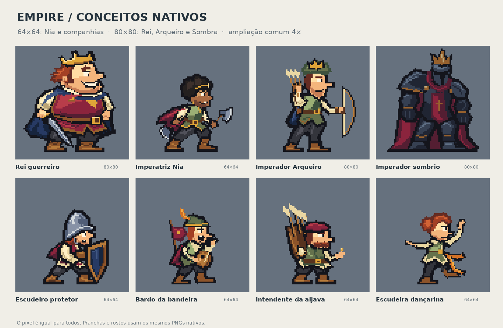

# Empire — imperadores: refinamento nativo V7

18/10/2026. Conceitos para avaliação de Henrique. A V7 é um refinamento das fontes nativas V6; não constitui aprovação artística nem integração no jogo.



[Abrir a inspeção interativa](inspecao.html): corpo em tamanho real, ampliação inteira, expressões, fundo claro/escuro, valores e grelha.

## Construção efetiva

Nia e os companheiros usam quadros 64×64. Rei, Arqueiro e Sombra usam 80×80, proposta para “um pouco maior”. O pixel tem a mesma dimensão para todos. O quadro inclui margens, roupa e equipamento; não equivale à altura da figura.

| Personagem | Quadro PNG | Área opaca útil | Recorte da cabeça |
| --- | --- | --- | --- |
| Rei guerreiro | 80×80 | 66×73 | 40×32 |
| Escudeiro protetor | 64×64 | 47×54 | 24×27 |
| Imperatriz Nia | 64×64 | 55×56 | 25×25 |
| Bardo da bandeira | 64×64 | 36×55 | 25×28 |
| Imperador Arqueiro | 80×80 | 52×67 | 24×30 |
| Intendente da aljava | 64×64 | 44×58 | 23×23 |
| Imperador sombrio | 80×80 | 66×74 | 18×31 |
| Escudeira dançarina | 64×64 | 44×52 | 25×23 |

Medidas geradas a partir do manifesto. A cabeça é recortada do PNG corporal; não foi desenhada como retrato maior. As pranchas usam os PNGs nativos ampliados por nearest neighbor.

## Continuidade e decisões

Foram consultados o arquivo de pesquisa da sessão anterior, as decisões/rejeições de Henrique, os capítulos de pesquisa aplicada, os estudos de luz/sombra, os limites dos ensaios anteriores, a referência de rei/escudeiro anexada nesta sessão e a referência de Sombra/dançarina preservada no repositório. O conteúdo recuperado do chat indicado foi cruzado com esse arquivo. O endereço privado do chat não abriu no leitor público; não se afirma uma leitura direta integral desse endereço.

- A referência apreciada do Rei continua a orientar barriga coberta, coroa torta, cabelo/costeletas, roupa vinho, mangas claras e capa azul. A V7 revê os grupos faciais para um sorriso lateral, falsa coragem, dor ofendida e orgulho na vitória.
- O escudeiro mantém elmo, escudo, roupa e escala; a expressão de base é apreensiva. O olho e a boca usam o espaço real que a aba deixa livre.
- Nia conserva a identidade de mulher negra adulta, cabelo natural, aro baixo, capa e duas machadinhas. As massas de cabelo foram arredondadas; nariz curto, sobrancelha e boca foram trabalhados na sua própria anatomia. A lâmina e a pega das armas têm grupos distintos.
- O Bardo articula a abertura vertical da boca com o olhar de canto. O Arqueiro mantém rosto comprido, olhar estreito e satisfação contida; não recebe o sorriso largo do Rei.
- O intendente mantém o bigode como camada persistente. O movimento facial fica por baixo; não surge barba nova.
- A dançarina mantém as formas do corpo, cabelo, figurino e gesto da V6, conforme a orientação de preservar a identidade apreciada.
- Sombra mantém visor vazio, ferro escuro e ombreiras desiguais. A gola vinho e a separação entre placas reforçam a construção; em repouso senta diretamente no chão. A floração preserva os estudos separados de broto, botão e flor da V6.

A V7 aplica luz superior esquerda, planos amplos nos tecidos e acentos curtos no metal. Narizes partilham a rampa do rosto. A paleta foi ajustada como conjunto; não se aplica uma mancha vermelha ao nariz ou ao estado ferido.

## Pesquisa aplicada

O arquivo completo continua em [pesquisa de 18/10](https://github.com/henriquecoding/empire/tree/codex/archive-imperadores-research-2026-10-18/docs/art/research/2026-10-18-imperadores-escudeiros). As antigas propostas 96/128 não foram tratadas como tamanhos aprovados.

Fontes primárias reabertas para esta revisão:

- [Saint11 — Cluster Sketching and Painting](https://saint11.art/pixel_art_articles/article2/): massas contíguas e limpeza dos degraus antes de detalhes.
- [Saint11 — Basic Shading](https://saint11.art/pixel_art_articles/article4/): volume, sombra entre peças e diferenças de material.
- [SLYNYRD — Light and Shadow](https://www.slynyrd.com/blog/2018/6/15/pixelblog-6-light-and-shadow): direção luminosa definida para comparar os materiais.
- [SLYNYRD — Knights, Monsters & Castles](https://www.slynyrd.com/blog/2025/7/28/pixelblog-57-knights-monsters-amp-castles): anatomia antes da armadura e custo do detalhe em animação.

As dimensões, personagens e escolhas cromáticas são decisões desta proposta; não são regras universais das fontes.

## Fontes editáveis e conferência

- `sprites/`: corpos transparentes na dimensão final.
- `expressions/`, `heads/`: estados estáticos e os seus recortes exatos.
- `aseprite/`: camadas editáveis e estados nomeados.
- `source/`: coordenadas inteiras, regras faciais por anatomia, planos de material, paleta e exportação.
- `diagnostics/`, `manifest.json`, `validation.json`: silhueta, valores, medidas e verificação técnica.

Reprodução com a dependência Pillow já prevista no projeto:

```sh
python3 source/build.py
python3 source/verify.py
```

O rasterizador pinta diretamente na grelha final; não abre as referências como entrada, não reduz ilustrações e não as quantiza. A atribuição de índices de paleta é exata. Os Aseprite são reabertos pelo leitor existente do Empire e comparados pixel a pixel com os PNGs. A verificação cobre dimensões, alfa 0/255, margens, origem do chão, recortes, estados distintos e camadas de identidade permanentes.

Esta revisão edita as fontes de construção nativa que já existiam no repositório. Não usou geração de imagens nesta iteração. As imagens grandes de desenvolvimento da V6 não foram amostradas para produzir os pixels.

## Limites

Estudos estáticos de corpo, roupa, rosto e repouso. A floração tem estados de comparação; não é uma sequência temporal acabada. Caminhada, ataques, bloqueios, descida e levantar permanecem por animar. As expressões não constituem reações corporais completas.

A validação técnica não determina beleza, personalidade ou aprovação do autor. Não foi executado o jogo nesta revisão. Nenhum asset do runtime é substituído.
