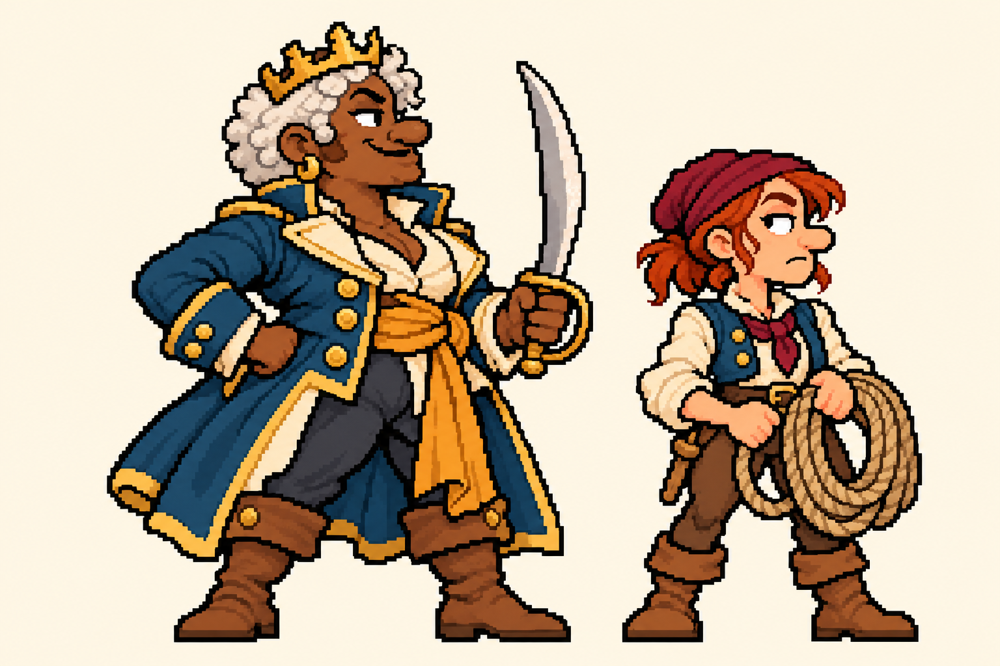
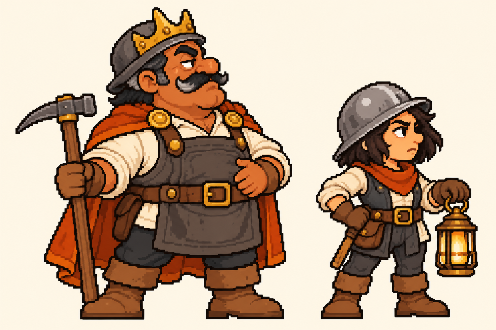
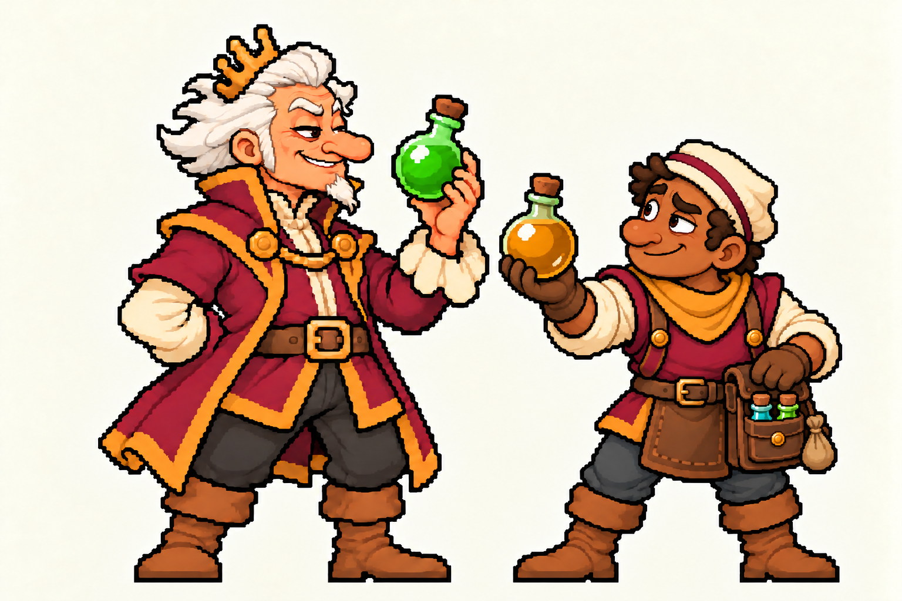

# Elenco escolhido para a Forja — 28–29/10/2026

Os conceitos abaixo foram escolhidos por Henrique. As revisões do alquimista e do seu
escudeiro executam pedidos posteriores: traços asiáticos com o nariz longo original,
e gesto de ajudante que entrega a próxima poção. A decisão de design não declara aprovação
de sprites nativos, animações ou integração Godot.

## Usar na Forja

```bash
python3 -m tools.forja elenco
python3 -m tools.forja elenco --character escudeiro_alquimista -o build/forja/ajudante-alquimista
python3 -m tools.forja plan "imperador alquimista" --character alquimista -o build/forja/alquimista
```

O MCP expõe `forja_elenco`. Os comandos `prompt`, `plan` e `auto` resolvem o mesmo
`--character` quando não se passa um `--fidelity` explícito. O plano anexa somente
o recorte correto, transmite as invariantes e usa a tela do personagem. A chamada
`elenco` não acede à rede. Um `auto` continua sujeito aos jobs e tetos já existentes.

## Conceitos e decisões

| Id | Conceito | Tela de destino | Decisão do dono |
| --- | --- | --- | --- |
| `corsair_empress` | [Imperatriz Corsária](contracts/corsair_empress.json) | 80×80 | Adorei de verdade os 3 designs |
| `corsair_squire` | [Escudeira das cordas](contracts/corsair_squire.json) | 64×64 | Adorei de verdade os 3 designs |
| `miner_emperor` | [Imperador Mineiro](contracts/miner_emperor.json) | 80×80 | Adorei de verdade os 3 designs |
| `miner_squire` | [Escudeira lanternista](contracts/miner_squire.json) | 64×64 | Adorei de verdade os 3 designs |
| `alchemist_emperor` | [Imperador Alquimista](contracts/alchemist_emperor.json) | 80×80 | Adorei de verdade os 3 designs; fazer o alquimista asiático; O nariz estava otimo antes. |
| `alchemist_squire` | [Escudeiro do alquimista](contracts/alchemist_squire.json) | 64×64 | O escudeiro do alquimista deveria fazer mais sentido para ele; funcionalidade compatível. |
| `cook` | [Cozinheiro](contracts/cook.json) | 64×64 | O cozinheiro ficou otimo. |
| `diplomat_original` | [Diplomata cómico original](contracts/diplomat_original.json) | 64×64 | Adorei esse, faça outros modelos sexos e etinias tambem. |
| `diplomat_08` | [Diplomata 08](contracts/diplomat_08.json) | 64×64 | Gostei do 8 e do que tinha criado antes que eu aprovei. |
| `builder` | [Construtora](contracts/builder.json) | 64×64 | Adorei os 3 ultimos e a segunda (lote 09-16: 10, 14, 15 e 16). |
| `mercenary` | [Mercenária](contracts/mercenary.json) | 64×64 | Adorei os 3 ultimos e a segunda (lote 09-16: 10, 14, 15 e 16). |
| `farmer` | [Camponês com nabo](contracts/farmer.json) | 64×64 | Adorei os 3 ultimos e a segunda (lote 09-16: 10, 14, 15 e 16). O senhor com o nabo na mão estava perfeito. |
| `steward` | [Intendente do livro-caixa](contracts/steward.json) | 64×64 | Adorei os 3 ultimos e a segunda (lote 09-16: 10, 14, 15 e 16). |
| `root_berserker` | [Berserker da raiz](contracts/root_berserker.json) | 64×64 | Gostei do berserker da raiz e do ultimo somente; nao quero personagens plantas. |
| `spearman` | [Lanceiro barrigudo 12B](contracts/spearman.json) | 64×64 | Gostei do berserker da raiz e do ultimo somente (ultimo: lanceiro 12B). |

A seleção anterior corresponde ao cozinheiro, ao diplomata cómico inicial, ao
diplomata 08 do lote de oito variações e aos conceitos 10, 14, 15 e 16 do lote
09–16. Do lote seguinte entram o berserker da raiz e o lanceiro 12B. As versões
posteriores sem aprovação não substituem esses originais. A ordem das oito
variações diplomáticas foi recuperada dos ficheiros da mesma entrega de 28/10,
14:20 UTC; `diplomat-08.png` é a oitava imagem dessa sequência.

## As novas duplas







## Preservação e revisão

- `images/` conserva os originais sem redução ou quantização; `sources.json` identifica-os.
- `contracts/` fixa o hash dos bytes, o recorte, as invariantes e o papel de cada personagem.
- `reviews/` regista a observação visual do recorte exato pelo hash dos pixels.
- `refs.json` mantém o estado `concept`: nenhum destes originais é um mestre nativo aprovado.
- `history/` guarda os recortes substituídos por pedido do dono. O nariz encurtado e
  os escudeiros com escudo ou caixa/pinça são recusados como candidatos das respetivas identidades.
- As caixas críticas no destino continuam pendentes; devem ser anotadas no sprite
  efetivamente desenhado. A área útil escolhida não demonstra que o gerador a cumpriu.
- Horta permanece uma civilização humana. O nabo é um produto transportado pelo camponês.
- O escudeiro real já estabelecido não é substituído pelos novos escudeiros.

As funções aqui descritas explicam o design e o equipamento. Não acrescentam
habilidades, classes jogáveis, números de balanceamento ou eventos à simulação.

## Função visual do escudeiro do alquimista

Boticário é o termo antigo para quem preparava remédios. Para comunicar melhor a
ajuda ao imperador, o escudeiro agora oferece a próxima poção com uma mão e
retira os suprimentos de uma bolsa compacta com a outra. Sai a caixa pesada e
a pinça. A bolsa, a dose pronta e o gesto de entrega explicam o apoio.

A preparação e entrega de doses são uma proposta de função. Não há uma mecânica
de produção, recarga, cura, dano ou consumo de poções implementada nesta tarefa.

## Frasco partilhado e expressão — revisão seguinte

O frasco entregue pelo escudeiro usa o mesmo molde e porte do que o imperador
segura. A diferença entre telas de 64×64 e 80×80 não reduz o objeto transportado:
os futuros sprites devem partilhar as dimensões nativas do frasco. Essas medidas
continuam por fechar no mestre nativo. O escudeiro ganha sobrancelhas assimétricas,
um olhar cético mais adulto e um meio sorriso, com gorro dobrado, lenço legível,
ombros e cotovelos limpos e apoio coerente para o frasco.
