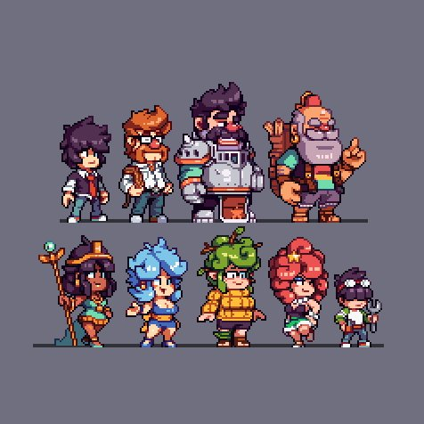
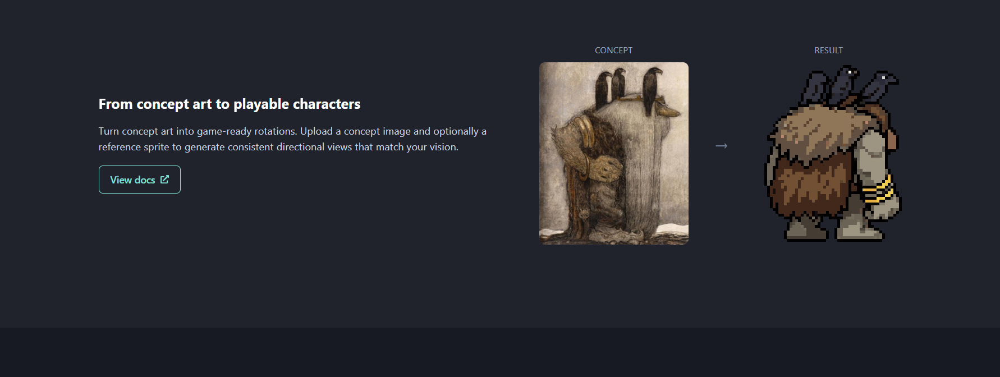

# Personagens compactos em 64×64 e o processo do PixelLab

Pesquisa de 18/10/2026, continuada a pedido de Henrique. As fontes abaixo foram consultadas diretamente na web. Estado: pesquisa concluída; reconstrução artística dos personagens pendente. Não houve teste dos modelos do PixelLab nem nova aprovação visual.

## Correção de direção dada pelo autor

Henrique considerou somente Rei e Sombra razoáveis na prancha posterior, ainda insatisfatórios, e rejeitou a leitura dos demais. Pediu personagens compactos e detalhados como a referência `FA5jMEvXMAET6d0.jpeg`, que descreveu como feita em 64×64. Também pediu estudar o processo conceito → sprite do PixelLab.

Isso atualiza o estado histórico do arquivo anterior: a elaboração foi retomada nesta conversa. As versões geométricas V6/V7 e as reduções posteriores não se tornam referências aprovadas. Nia e companheiros continuam com quadro pedido de 64×64; os demais imperadores podem ser um pouco maiores. 80×80 continua sendo ensaio do assistente, sem aprovação como dimensão definitiva.

## O que a referência efetivamente mostra

A cópia recebida é uma prancha JPEG de 476×476. O tamanho nativo individual foi informado pelo autor; esta cópia ampliada/comprimida não permite certificar sozinha o arquivo original de cada personagem. Não foi identificado o artista, nem atribuída autoria por suposição.

Observações visuais desta prancha:

- As cabeças recebem uma parte expressiva da área do personagem. Rosto, cabelo e barba têm espaço próprio; os olhos não ficam espremidos sob o equipamento.
- Troncos curtos e membros encorpados deixam mãos, punhos, botas e dobras distinguíveis. O personagem de armadura continua pesado, enquanto os menores conservam anatomias e posturas diferentes.
- Cabelo é organizado em mechas grandes, metal em placas e reflexos, roupa em volumes e poucas dobras relevantes. Esses agrupamentos carregam bastante informação.
- Contornos internos aparecem nas sobreposições que precisam ser separadas. Nem toda troca de cor recebe uma linha escura.
- Detalhes pequenos têm função: um brilho identifica metal; uma abertura identifica boca; um intervalo distingue mão de cintura. Não há uma textura miúda cobrindo todas as superfícies.

As imagens são referência de construção e acabamento. Não autorizam substituir o figurino ou a identidade do elenco de Empire pelos personagens da prancha.

## O que os artistas ensinam e como se aplica

Saint11 começa por massas de cor e as refina em grupos contíguos de pixels. Pontos isolados sem função tendem a gerar ruído; pontos intencionais, como olhos, podem funcionar. Aplicação: desenhar a mecha, a bochecha e a manga como formas antes dos fios, poros ou pequenos vincos. [Cluster Sketching and Painting](https://saint11.art/pixel_art_articles/article2/)

No exercício de luz de Saint11, a imagem em baixa resolução muda proporções e amplia olhos e boca em relação à redução da foto para melhorar a leitura. Aplicação: redesenhar o rosto para o espaço disponível, conservando sua anatomia e expressão. [Basic Shading](https://saint11.art/pixel_art_articles/article4/)

SLYNYRD explica que personagens pequenos frequentemente condensam a anatomia e dão mais espaço à cabeça. O exemplo é de câmera superior; a relação numérica daquele exemplo não é uma regra para a câmera lateral de Empire. O princípio útil é reservar espaço às feições. [Top Down Character Sprites](https://www.slynyrd.com/blog/2019/10/21/pixelblog-22-top-down-character-sprites)

No estudo de cavaleiros, SLYNYRD estabelece anatomia e peças de armadura antes de refinar a iluminação. Recomenda evitar muitos grupos pequenos dispersos e transições excessivamente graduais. Aplicação: placas de Sombra, mãos, cotovelos e apoio devem ser legíveis antes dos reflexos e ornamentos. [Knights, Monsters, & Castles](https://www.slynyrd.com/blog/2025/7/28/pixelblog-57-knights-monsters-amp-castles)

Derek Yu demonstra como cores quase iguais enfraquecem a leitura. Saint11 também mostra como suavização excessiva e faixas paralelas de tons podem produzir aparência borrada. Aplicação: separar materiais e planos com cores úteis, sem impor uma contagem arbitrária de cores a todo o elenco. [Common Mistakes](https://www.derekyu.com/makegames/pixelart2.html) · [Anti-Alias and Banding](https://saint11.art/pixel_art_articles/article5/)

## Por que a entrega anterior falhou

O processo anterior gerou figuras grandes, isolou seus corpos e reduziu proporcionalmente com nearest neighbor e quantização. Isso não redesenhou feições, proporções ou agrupamentos para a resolução final. Evitar interpolação não recupera informação que deixou de caber.

As caixas abaixo foram medidas nos pixels com alfa maior que zero dos PNGs entregues; incluem cabelo e acessórios. Não representam aprovação artística nem medida isolada do corpo.

| Personagem | Quadro entregue | Caixa visível, largura × altura | Problema observado |
| --- | --- | --- | --- |
| Rei | 80×80 | 76×69 | Silhueta ampla resistiu melhor; feições ainda frágeis |
| Nia | 64×64 | 54×50 | Cabelo e armas disputam espaço com rosto e mãos |
| Arqueiro | 80×80 | 56×68 | Anatomia alongada e detalhes internos competem |
| Sombra | 80×80 | 70×73 | Grandes massas resistem melhor; brilho disperso ainda precisa revisão |
| Escudeiro | 64×64 | 43×40 | Quadro de 64 não significa corpo com 64 pixels de altura |
| Bardo | 64×64 | 41×58 | Estandarte consome parte da altura; rosto e instrumento ficam comprimidos |
| Intendente | 64×64 | 47×51 | Aljava domina; mão, bigode e roupa perdem separação |
| Dançarina | 64×64 | 36×44 | Membros finos e rosto pequeno se desfazem na redução |

Há espaço vazio legítimo num quadro, especialmente para animação e diferença de porte. A correção não é esticar todos até a mesma altura: é planejar a anatomia compacta e o espaço dos detalhes mantendo a escala relativa do elenco.

## O que o PixelLab documenta

Na captura, as aves no dorso, o corpo volumoso e os braceletes continuam reconhecíveis. Texturas finas do conceito são reinterpretadas como formas de material. Essa observação visual não revela, sozinha, o algoritmo.

| Operação | O que está documentado | Uso pertinente |
| --- | --- | --- |
| Conceito + estilo | Recebe referências do personagem e, separadamente, uma imagem de estilo pixel art | Conceito de Empire informa identidade; prancha compacta informa acabamento |
| Geração com referências | Permite referências de assunto e controles de paleta, contorno, detalhe e sombra | Evitar que uma referência de estilo troque roupa ou aparência do personagem |
| Resize com IA | Redesenha a arte para a dimensão escolhida; recomenda mudanças grandes em etapas | Adaptar proporções e detalhes quando o tamanho muda |
| Unzoom | Detecta a escala dos pixels e recupera a grade de arte ampliada | Examinar uma referência que já é pixel art antes de reinterpretá-la |
| Inpainting | Altera uma região e usa o restante preservado como contexto | Corrigir um rosto ou uma mão sem recriar todo o personagem |

Fontes oficiais: [Conceito + estilo](https://www.pixellab.ai/docs/tools/create-8-rotations-pro) · [Geração Pro](https://www.pixellab.ai/docs/tools/create-sl-image-pro) · [Resize](https://www.pixellab.ai/docs/tools/resize) · [Unzoom](https://www.pixellab.ai/docs/tools/unzoom-pixelart) · [Inpainting](https://www.pixellab.ai/docs/options/inpainting).

### Verificações adicionais na API pública

A [especificação oficial](https://api.pixellab.ai/v2/openapi.json), consultada nesta data, distingue conversão com `output_size` de conversão Pro com tamanho automático. No conversor comum, `fixer=true` favorece fidelidade; `init_image_strength` útil é 100–300. O próprio campo desaconselha exagerar a força, pois quase não transforma a origem. A descrição desse conversor menciona difusão iniciada pela imagem. Pro Flash também documenta recuperação de grade com o conversor fiel quando necessária. Isso não descreve toda a arquitetura ou o treinamento. Na criação de personagens, o quadro armazenado pode crescer: conferir o PNG final continua necessário.

As faixas de força de outros modelos não devem ser transferidas automaticamente a esse conversor. A documentação do plugin e a API também usam convenções de máscara diferentes em certas ferramentas; consultar a operação escolhida antes de aplicar uma máscara.

O que se pode concluir: o produto combina referências, geração/reescrita de imagem, tratamento da grade e correções locais. Não há base para afirmar que todas as ferramentas pintam diretamente numa grade de 64 durante toda a computação. Também não há garantia de preservação perfeita ou de qualidade em todos os resultados.

## Aplicação concreta à elaboração de Empire

Este é um roteiro de produção proposto pelo assistente, ainda sem validação visual:

1. Escolher um personagem e uma pose de corpo inteiro. Conservar o conceito de identidade separado da referência de acabamento.
2. Se a origem já tiver pixels ampliados, identificar sua grade antes de transformar. Uma prancha inteira com vários personagens não deve ser tratada como um único sprite de 64×64.
3. Planejar o corpo compacto na dimensão final. Como ensaio para Nia/companheiros: cabeça com cerca de 18–22 pixels de altura incluindo cabelo/elmo, rosto com espaço próprio, tronco curto e mãos distinguíveis. Esses números são orçamento inicial, não regras universais ou decisões de Henrique.
4. Reservar espaço a olhos, sobrancelhas, nariz na rampa da pele e boca. Projetar sua expressão no corpo completo. Um retrato grande separado não demonstra legibilidade do sprite.
5. Organizar tecido em volumes, cabelo em mechas e metal em planos. Usar detalhe pequeno onde comunica forma, expressão ou material.
6. Preservar regiões que já funcionam e corrigir localmente as que falham. Conferir a anatomia e o apoio antes de acabamento.
7. Inspecionar o PNG final a 1× e em ampliação inteira, com a cabeça recortada dos mesmos pixels. Verificar figurino, rosto, materiais e identidade antes de derivar rotações ou animações.

| Personagem | Construção a resolver sem perder identidade |
| --- | --- |
| Rei | Barriga, bochechas e queixo duplo; olhar pesado, sorriso e coroa inclinada com espaço próprio |
| Escudeiro | Elmo arredondado, olhos e boca expostos, apreensão; mãos e escudo separados |
| Nia | Identidade de mulher negra adulta; mandíbula, sobrancelhas e olhar legíveis; cabelo, coroa, mãos e machados organizados sem sobreposição confusa |
| Bardo | Bochechas, nariz e boca de canto; chapéu, mãos e alaúde distinguíveis; compor o estandarte sem esvaziar o corpo |
| Arqueiro | Rosto comprido como identidade, com corpo condensado; olho de mira, nariz e sorriso; arco fora da massa da roupa |
| Intendente | Rosto quadrado e bigode persistente; mão de cobrança clara; aljava e flechas agrupadas |
| Sombra | Massa pesada, elmo fechado e planos de armadura legíveis; repouso diretamente no chão para a floração |
| Dançarina | Coque ruivo, mangas claras, roupa sálvia e fitas laranja; apoio leve e articulações claras sem membros se dissolverem |

A amostra seguinte precisa demonstrar essa construção. Um arquivo com dimensões corretas ou uma imagem apenas serrilhada não encerra o trabalho artístico.

## Limite desta entrega

Foram analisadas as duas imagens enviadas, consultados tutoriais de artistas e verificados documentos e esquema da API oficial do PixelLab. Nenhuma imagem foi enviada ao serviço e nenhum modelo dele foi executado. A ferramenta de geração disponível nesta conversa não equivale a uma integração do PixelLab; resultados dela precisam ser avaliados como resultados dessa ferramenta.
