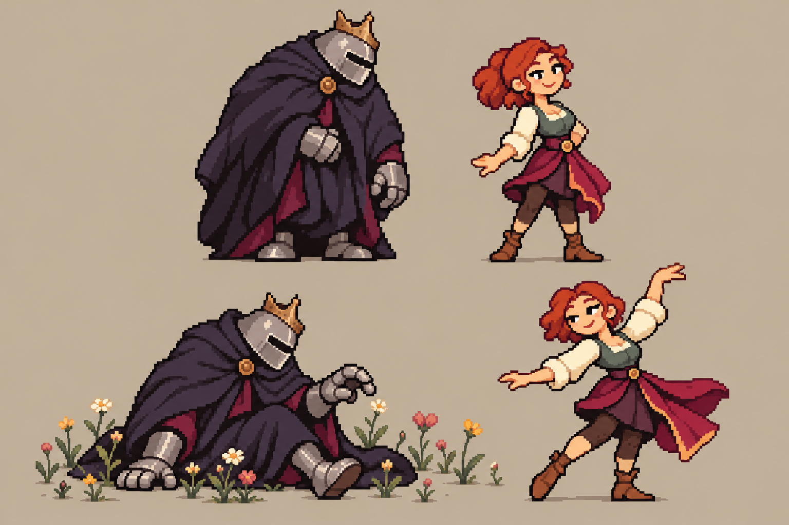

# Decisões, rejeições e estado atual

Consolidação de 19/10/2026. As mensagens do autor prevalecem sobre autoavaliações do assistente. O [registro de 18/10](../2026-10-18-imperadores-escudeiros/DECISOES-DO-AUTOR.md) é histórico, não o encerramento das revisões posteriores.

## Pedido e alcance da aprovação

O autor pediu refazer design/animação de Sombra e melhorar a bailarina pensando na dupla. Rejeitou o floral por parecer que flores deitadas giravam para cima: cada flor deve crescer aleatoriamente, uma a uma. Após nova crítica, pediu pesquisa profunda, depois criação com o aprendizado. Diante da nova prancha, respondeu **"Achei interessante, pode seguir com esse"**.

Esse aceite refere-se à prancha mostrada. Não aprova antecipadamente todos os frames, o importador, a integração ou os demais personagens. O pedido seguinte foi implementar no repositório o conhecimento e a pesquisa adquiridos.

## Evolução e lições

| Revisão | Ocorrência | Consequência |
|---|---|---|
| V5 e conceitos iniciais | Estrutura, escala, expressão, materiais, luz e flores estudados; rodada final daquela etapa rejeitada | Preservar fontes/preferências e consultar o estado antes de reutilizar imagens |
| V8–V11 | Ensaios compactos e refinamento de rostos/corpos; V11 usada como base estática | PNG pequeno e paleta limitada não bastam; comparar corpo inteiro ao elenco |
| V12 | Máscaras, rotação/deslocamento e deformação da pose parada | Faltavam poses de passagem; braços ilegíveis e sentar sem apoio convincente |
| V13 | Poses completas, correções de alaúde/arco/entrega e verificação técnica | Sombra/dupla ainda desagradavam; floral transformava uma imagem pronta |
| Primeira V14 | Repetia armadura cerimonial com ornamentos florais; produção interrompida | Decoração não resolveu estrutura; geração não garantiu contagem de poses |
| Pesquisa e nova prancha | Sombra recolhido sob manto, bailarina leve e plantas individuais | **Design aceito para continuar**, referência preservada abaixo |
| V15 | Novo Sombra, bailarina e jardim; outros seis mantidos da V13 | Arquivos tecnicamente conferidos; animação aguarda revisão artística e teste Godot |
| Consolidação | Pesquisa, método, prompts e evidências ligados ao fluxo do projeto | Conhecimento operacional; não equivale a instalar os sprites no runtime |

## Direção visual aceita para a dupla

**Sombra:** postura recolhida, cabeça baixa, capacete fechado simples cinza, pequena coroa de bronze torta, grande manto carvão/violeta com interior ameixa, luvas/botas prateadas e fecho discreto. Massa de tecido dominante. Evitar retornar às ombreiras largas, peitoral exposto e bordas douradas das tentativas rejeitadas. Rosto oculto.

**Bailarina:** adulta, ruiva, cabelo preso compacto, rosto expressivo, blusa creme, corpete sálvia, saia vinho assimétrica em duas massas, meias opacas e calçado baixo castanho. Braços, pernas e apoio legíveis. Afinidade por vinho/ameixa, bronze e atuação, sem exigir broche e flor no cabelo repetidos.

**Atuação proposta:** presença pesada e gesto cuidadoso de Sombra diante de algo pequeno; bailarina curiosa e leve. Não acrescenta história ou mecânica. A prancha aceita fixa a direção visual; cada gesto na timeline ainda exige revisão.

## Floral

Raiz fixa; estágios próprios de broto/caule/botão/pétalas; início por planta em ordem embaralhada; crescimentos sobrepostos; sorteio estável por ativação; frente/fundo por planta inteira; saída própria. Não voltar ao tapete comprimido, faixas atrasadas ou plantas inteiras girando como placas.

A ordem aleatória é direção para este efeito mágico. As fontes botânicas não demonstram que toda planta floresce em ordem aleatória ou pelo mecanismo do lírio.

## O que a V15 declara

- Sombra 80×80 e bailarina 64×64; esquerda espelha direita, luz e roupa incluídas.
- Sombra tem levantar próprio; bailarina reutiliza queda invertida em `rise`.
- Jardim demonstrativo de 28 plantas/12 segundos; espécies e alturas exportadas, estágios separados e raiz fixa.
- Poses geradas em pranchas maiores, extraídas, alinhadas e quantizadas; não autoria manual original em 64/80.
- Verificação técnica passou; não houve execução Godot, abertura no aplicativo Aseprite ou teste de runtime do visualizador no navegador.
- Ligação de ações, eventos, slots de equipamento, sockets e RNG ao projeto continua pendente.
- A animação V15 não recebeu aprovação artística explícita do autor.

Ler contagens e medidas no [relatório](evidencias/v15/verificacao.json), [extração](evidencias/v15/extracao.json) e [agenda](evidencias/v15/jardim-padrao.json). Não deduzir número de desenhos da quantidade pedida ao gerador.

## Próxima produção

Partir da prancha aceita e do método consolidado. Rever a 1× atuação, transferência de peso da dança e abertura das plantas. Corrigir falhas antes de expandir; resolver divergências de tela, contagem e timing com as bíblias antes da integração.
