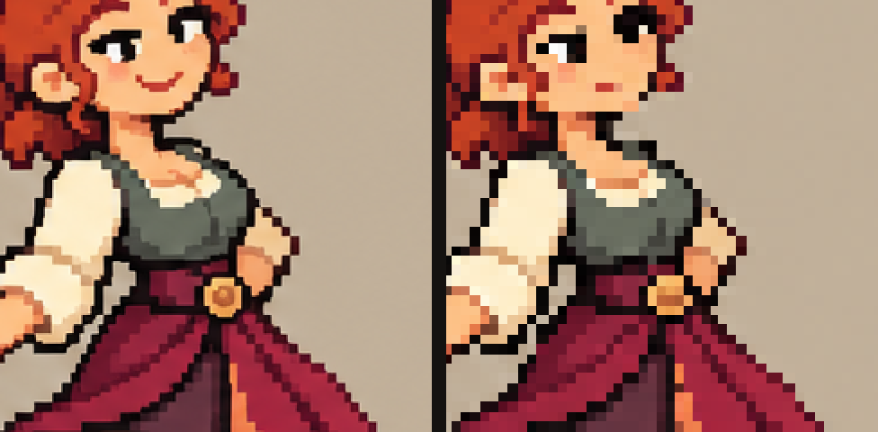

# PixelLab por dentro e a Forja — pesquisa de 23/10/2026

Pedido de Henrique: fazer uma engenharia reversa densa do [PixelLab](https://www.pixellab.ai)
e pôr no repositório uma ferramenta completa, melhor que a original, para que
agentes que geram imagens bem (o ChatGPT, por exemplo) trabalhem com pixel art
exatamente como o projeto pede. O resultado é a [Forja](../../FORJA.md)
(`tools/forja/`), decidida na [ADR 0088](../../../adr/0088-a-forja-de-pixel-art.md). "Melhor que a
original" é o pedido, não um resultado: nenhum benchmark comparável foi feito. A
[auditoria de 23/10](../2026-10-23-pixellab/AUDITORIA-FORJA-CLAUDE.md) qualificou as frases
abaixo e achou nove falhas, reparadas em [2026-10-23-forja-reparos](../2026-10-23-forja-reparos/README.md)
(ADR 0089).

A 26/10 a [engenharia reversa continuou](../2026-10-26-pixellab-engenharia-reversa/README.md): o
contrato mudou, o adaptador PixelLab passou a conferir limites por eixo e intervalos, e a grade deixou de
destruir sprites nativos.

Esta pasta guarda o que foi lido e medido. Continua o estudo de 18/10
([pixel art compacta e PixelLab](../2026-10-18-imperadores-escudeiros/PIXEL-ART-COMPACTA-E-PIXELLAB.md)),
que já documentava conceito + estilo, resize, unzoom e inpainting.

## O que foi acessado

Fontes lidas diretamente nesta data. Nenhum modelo do PixelLab foi executado
(sem conta nem chave); nenhuma API de geração foi chamada.

| Fonte | O que deu |
| --- | --- |
| [Documentação do produto](https://www.pixellab.ai/docs) e páginas de ferramentas e opções | Inventário das ferramentas (criar, editar, rodar, animar, mapas, inpainting, reduzir cores) e dos controlos |
| [API v2](https://api.pixellab.ai/v2/llms.txt) e a [especificação OpenAPI](https://api.pixellab.ai/v2/openapi.json) | 113 operações, parâmetros, enums, trabalhos assíncronos, custos |
| [Servidor MCP](https://api.pixellab.ai/mcp/docs) e o [README público](https://github.com/pixellab-code/pixellab-mcp) | 118 ferramentas para agentes, modelo de trabalhos e esperas |
| [Página da API](https://www.pixellab.ai/pixellab-api) | Limites e preços estimados por chamada |
| unfake ([artigo](https://dev.to/jenissimo/how-to-tame-your-ai-pixel-art-3pk5), [PyPI](https://pypi.org/project/unfake/)), [perfectPixel](https://github.com/theamusing/perfectPixel), [Pixel Snapper](https://github.com/Hugo-Dz/spritefusion-pixel-snapper), [NUILab](https://aigaming.nuilab.org/workflows/pixel-perfect-output/) | Como as ferramentas abertas recuperam a grade de pixel art gerada |
| OpenAI: [edits](https://developers.openai.com/api/reference/python/resources/images/methods/edit), [generate](https://developers.openai.com/api/reference/python/resources/images/methods/generate), [guia](https://developers.openai.com/api/docs/guides/image-generation), [prompting](https://developers.openai.com/api/docs/guides/image-prompting) | Modelos gpt-image atuais, tamanhos, transparência, máscaras |
| Gemini: [geração de imagem](https://ai.google.dev/gemini-api/docs/image-generation), [modelos](https://ai.google.dev/gemini-api/docs/models), [generateContent](https://ai.google.dev/api/generate-content) | Modelos Nano Banana, Interactions API, referências |

## Como o PixelLab se organiza

O PixelLab é uma família de modelos treinados para pixel art (Pixflux, Pixen,
Bitforge, linhas "Pro" e "Pro Flash", animação v3 e PixMiniMax) servida por
web, extensão do Aseprite, editor Pixelorama, API e MCP. O que a documentação
mostra do processo:

- **Entrega na resolução pedida.** Os tamanhos pedidos à API são os do sprite
  (16 a 512 px), não os de uma ilustração a reduzir. Como os modelos atuais
  desenham por dentro não está publicado nas fontes lidas. Os modelos "Pro" geram uma grelha de
  candidatos (até 64 imagens de 32 px numa só chamada) e cobram pelo tamanho.
- **Controlos fracos e fortes.** Contorno (`single color black outline`,
  `single color outline`, `selective outline`, `lineless`), sombreamento (`flat`
  a `highly detailed shading`), detalhe, vista (`side`, `low top-down`,
  `high top-down`) e direção são "orientação fraca". Imagem inicial com força
  (1–999), imagem de cor que força a paleta e inpainting com máscara são os
  controlos fortes. A própria documentação recomenda partir de uma imagem
  inicial quando a vista ou a direção não obedecem.
- **Identidade por referência.** Personagens guardados no servidor; rotações
  a partir de um sprite virado a sul; estados (roupa, pose) como edição de
  texto sobre a referência; "fixed head" copia a cabeça de referência em todos
  os quadros de uma animação por esqueleto (COCO-18: nariz, pescoço, ombros,
  cotovelos, pulsos, ancas, joelhos, tornozelos, olhos, orelhas).
- **Animação.** Por texto a partir do primeiro quadro (que fica igual), com
  último quadro opcional para interpolar; por esqueleto quadro a quadro; por
  modelos de animação prontos (caminhar, correr, ataques). Um
  `drift_threshold` contra a cintilação de cor entre quadros.
- **Pós-processamento local.** `unzoom` (recuperar a grade de pixel art
  ampliada, menos de um segundo, local), `correct-pixelart`, `reduce-colors`
  com dither 2×2/4×4/8×8, remoção de fundo simples ou complexa, mapa de normais.
- **Tiles.** Conjunto Wang de 16 por cantos (`corner/4` = `NW<<3|NE<<2|SW<<1|SE`)
  entre um terreno de baixo e um de cima, com faixa de transição; plataforma
  lateral de 16 tiles; tiles isométricos e hexagonais na linha Pro.
- **Para agentes.** O MCP devolve identificadores de trabalho; o agente espera
  com `wait_for_jobs` e lê com `get_*`. O servidor não lê ficheiros locais: as
  imagens entram por base64, URL ou upload.

Uma consequência que interessa ao Empire (inferência, não arquitetura
recuperada): a API do PixelLab entrega pixel art nas dimensões pedidas, sem uma
grade a recuperar do lado do cliente. Um gerador geral (gpt-image, Gemini) desenha
"estilo pixel art" — blocos de tamanho que deriva, bordas suavizadas, ruído,
cores a mais. A distância entre os dois é o que a Forja cobre.

## Como as ferramentas abertas recuperam a grade

| Ferramenta | Escala | Fase e linhas | Amostra por célula | Paleta |
| --- | --- | --- | --- | --- |
| unfake.js (artigo) | Sobel, histograma das distâncias entre picos | pente de força bruta | cor dominante com margem de 5%, senão média | Wu |
| unfake (PyPI) | "runs" (MDC) ou Sobel | não documentado | dominante, mediana, moda, média, Kopf-Lischinski | Wu |
| perfectPixel | FFT do espectro, Sobel de recurso | linha a linha, gananciosa, a partir do centro | centro, mediana, 2-means | — |
| Pixel Snapper | perfil de gradiente, picos | "walker" com janela e estabilização | não lido | k-means RGB (semente 42) |

Limites comuns: período inteiro ou estimado por um eixo de cada vez; pente pela
média (os múltiplos do período empatam); linhas que derivam nas zonas lisas;
cor em RGB. A Forja faz outras escolhas (sem comparação no mesmo conjunto de imagens): junta os dois eixos na autocorrelação, alarga o pico que as
células desiguais partem em dois, afina com um pente de contraste (dentes menos
meios entre dentes, onde múltiplos e submúltiplos perdem), prende as linhas a
uma reta refeita por mínimos quadrados e interpola nas zonas lisas, e mede a
cor em OKLab.

## Geradores de imagem nesta data

- **OpenAI.** O `gpt-image-1` deixa de funcionar a 23/10/2026; o `gpt-image-1.5`
  a 1/12/2026. Atuais: `gpt-image-2`, `gpt-image-2.5-sunburst` (qualidade) e
  `gpt-image-2.5-flare` (rápido). Tamanhos livres nos 2.x (lados múltiplos de
  16, proporção 1:3 a 3:1). Fundo transparente estável nos 2.5, em preview no 2.
  Edição com até 16 imagens e máscara (alfa 0 = mudar). A própria OpenAI
  aconselha compor a edição sobre o original quando uma região tem de ficar
  idêntica — a Forja fá-lo sempre.
- **Gemini.** Modelos de imagem estáveis: `gemini-nano-banana-2.1`,
  `gemini-3.1-flash-image`, `gemini-3-pro-image`, `gemini-2.5-flash-image`.
  A documentação de imagem usa a Interactions API; até 14 referências no 2.1.
  Não documenta fundo transparente; todas as imagens levam SynthID.

## Diferenças de desenho entre o PixelLab e a Forja

A coluna do PixelLab resume a documentação pública; a da Forja, o que está
implementado. Não é um ranking: nenhum benchmark comparável foi executado.

| PixelLab (documentado) | Forja (implementado) |
| --- | --- |
| Modelo próprio, na nuvem, pago por geração | Usa qualquer gerador; o processamento é local, determinístico e grátis |
| Paletas genéricas (Lospec, PICO-8…) | A paleta de trabalho do Empire, os contratos de tela, pivô, contorno, cluster e cadência da Asset Bible e da Animation Bible |
| `unzoom`, `correct-pixelart`, `reduce-colors` | `snap`, `clean`, `quantize`, com relatório do que decidiu |
| Animação gerada; a revisão do lado do PixelLab não foi verificada | Conta figuras pedidas e achadas, separa validade do contrato, indícios de movimento e aprovação; mantém deslocamentos; trava o rosto; prende cores |
| Wang 16 gerado por modelo | Wang 16 por campo contínuo com prova de costura zero, e `TileSet` do Godot com os bits de canto, carregado no motor |
| Exporta PNG, GIF, folhas | `.aseprite` com camadas, tags, durações, paleta e pivô; JSON do CLI do Aseprite; `SpriteFrames` do Godot |
| MCP remoto sem acesso a ficheiros locais | MCP local por caminhos do repositório, com a prévia como imagem |
| Se critica os resultados não foi verificado | Lint contra os contratos do Empire com correção sugerida e o prompt corretivo para a próxima geração |
| Proveniência a cargo do utilizador | Proveniência gravada em cada saída, com os estados de revisão do projeto |

O que a Forja **não** faz: não treina nem traz um modelo de pixel art. A
qualidade do desenho depende do gerador e do pedido. O PixelLab continua
disponível como gerador (`forja generate --backend pixellab`) para quem tiver plano.

## Medições desta sessão

A prova e a bancada fabricam distorções com verdade conhecida: mostram a
recuperação nesses tipos de distorção, não a qualidade de rostos, identidade ou
ações, nem uma vantagem sobre outras ferramentas.

- [prova.json](prova.json): a prova que corre no CI (`forja prova`).
- [bancada-150.json](bancada-150.json): a bancada pesada reproduzível
  (`forja prova --bench 150`): sprites e escalas sorteados de forma fixa, de 3 a
  40 px por pixel lógico, células desiguais até 12% do período, desfoque, ruído
  e três cores de chave. Os casos que falham ficam listados.
- Os recursos `TileSet` e `SpriteFrames` gerados foram abertos no Godot
  4.7.2-stable fixado (hashes conferidos com `tools/verify_godot.py`) pelo teste
  `test_resources_load_in_godot`, com Python 3.11 e o Pillow fixado.

## Imagens reais do projeto

Duas pranchas geradas em sessões anteriores, já versionadas como referência,
foram passadas pela Forja sem nenhum parâmetro ([imagens-reais.json](imagens-reais.json)):

| Prancha | Origem | Grade achada | Nativa |
| --- | --- | --- | --- |
| Sombra e bailarina (design aceito de 19/10) | 1536×1024, gpt-image | período 5,325 px, confiança 0,884 | [285×190](recuperada-sombra-bailarina.png) |
| Rei e escudeiro (preferência anterior de 18/10) | 1254×1254 | período 6,093 px, confiança 0,939 | [206×205](recuperada-rei-escudeiro.png) |

As comparações reconstroem a nativa sobre os cortes achados e põem-na ao lado
da origem, no mesmo recorte: [Sombra e bailarina](comparacao-sombra-bailarina.png)
e [Rei e escudeiro](comparacao-rei-escudeiro.png).

O que se viu:

- Corpo, roupa, contornos, coroa, armadura e flores voltam fiéis, pixel lógico
  a pixel lógico. Até o texto pequeno da segunda prancha se lê na nativa.
- O rosto da bailarina perde traços: o gerador desenhou o sorriso e os olhos
  mais finos do que a própria grade, e o voto por célula fica com a pele. Foi
  isto que levou ao aviso `subgrid`, ao mapa de células misturadas no relatório
  e à instrução do prompt ("whole pixels on the same grid… never lines thinner
  than one block"). Nenhuma heurística testada (incluindo preferir o tom mais
  escuro de cada célula) recuperou o sorriso sem engrossar contornos.
- Na prancha densa do rei e do escudeiro a separação automática juntou figuras
  que se tocam (2 manchas). Daí o recorte por célula com `--layout`, que separa
  figuras encostadas quando o pedido define a grelha (provado com uma prancha
  sintética de 8 figuras quase coladas).

Essas pranchas não foram pedidas com o compilador da Forja (grade lógica
explícita, blocos k×k, sem sub-pixel). O efeito do pedido compilado sobre o
rosto ainda não foi medido com um gerador real.

Não houve uso de chaves de API, chamadas reais aos geradores nem abertura no
aplicativo Aseprite. Nenhum asset do jogo foi produzido ou alterado.
