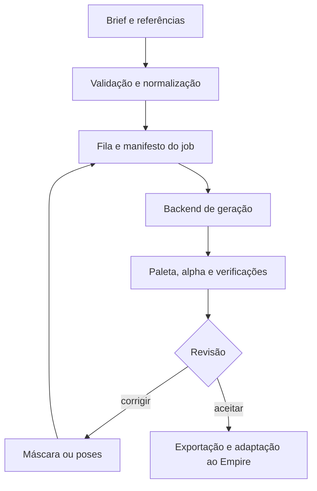

# Como construir uma ferramenta de pixel art comparável ao PixelLab

Pesquisa pública, engenharia reversa funcional e plano de implementação para o Empire e para o Claude.

**Data de corte: 23 de outubro de 2026.** Pedido de Henrique Passos. Repositório estudado: `henriquecoding/empire`, base `8a21352145cd3a9eed9a6324679b55faa93a948d`.

**Estado da entrega:** pesquisa e projeto técnico concluídos; treino próprio e benchmark de geração não executados. Este documento especifica uma implementação independente. Não contém pesos, código privado, base de treino ou receita interna recuperados do PixelLab.

**Atualização após o trabalho do Claude:** a Forja foi integrada pelo PR #117, no commit `68ed1c87461f5d39dd21fb664eef2930ddeaac81`. Ela já implementa processamento, contratos, exportadores, CLI/MCP e adaptadores de geração. A [auditoria da Forja](AUDITORIA-FORJA-CLAUDE.md) avalia esse código, reproduz nove observações e define a ordem de correção. As propostas abaixo devem ampliar essa base, sem criar uma ferramenta paralela. A entrega desta pesquisa não altera os módulos de produção da Forja. Os [resultados das sondas](forja-audit-observations.json) não são um benchmark de qualidade de geração.

## 1. A conclusão que orienta a construção

O caminho viável é construir um sistema especializado de produção de assets: geração condicionada por referências e geometria, manutenção de identidade, animação por poses, acabamento de pixels, avaliação e edição. A interface pública do PixelLab expõe vários desses mecanismos. Uma chamada a um modelo geral com a expressão “pixel art” cobre apenas uma parte do problema.

A evidência pública mais concreta de um modelo associado à marca é **Pixel Party XL**, publicado pela organização Pixel Lab no Hugging Face: um modelo baseado em SDXL cujo fluxo recomendado inclui redução por vizinho mais próximo. Isso demonstra uma rota histórica de implementação, mas **não identifica os modelos atuais Pixen, Pixflux, Bitforge ou Pro**. O nome comercial Pixflux, isoladamente, não prova que o modelo seja FLUX. A arquitetura e os pesos atuais permanecem desconhecidos. [P01]

Recomendo começar por uma ferramenta local de produção do Empire com três componentes separáveis:

1. Um editor/validador que funciona com imagens reais e conhece os contratos do projeto.
2. Um backend de geração substituível: baseline independente com um modelo licenciado; API PixelLab opcional para comparação ou uso autorizado.
3. Um pipeline de dados e avaliação que decide, com resultados, quando vale treinar um modelo especializado e uma extensão temporal.

A maior aposta técnica deve ser a **taxa de assets aceitos com pouco retrabalho**. Uma imagem bonita isolada não demonstra consistência de elenco, animação utilizável ou integração correta no jogo.

## 2. Como ler o relatório e o que foi investigado

As seções 3–6 descrevem fatos e limites das fontes. Da seção 7 em diante, a arquitetura, os algoritmos, os contratos e os números de planejamento são **propostas nossas**, salvo indicação explícita. As referências identificadas por `[Pxx]` estão no fim deste documento. O arquivo `FONTES.md` contém também o inventário completo das páginas oficiais consultadas; `proveniencia.json` registra URLs, tamanhos e hashes das respostas coletadas.

Foram estudados o catálogo público, a documentação das ferramentas e opções, a especificação OpenAPI, os textos públicos para agentes, os SDKs públicos, o modelo histórico, artigos científicos e os contratos existentes do Empire. Não houve chamadas pagas de geração, uso de credenciais, inspeção de tráfego autenticado, recuperação de código privado, treinamento de GPU ou teste visual comparativo de resultados novos. Capturas promocionais e descrições do fornecedor não são medições independentes.

Classificação usada:

| Rótulo | Significado | Consequência |
|---|---|---|
| Fato público | Está explicitamente numa fonte primária consultada | Pode orientar integração, com versão e data |
| Inferência | Explicação compatível com os fatos, sem confirmação interna | Precisa de experimento; não descrever como arquitetura do fornecedor |
| Proposta | Escolha de engenharia para nossa ferramenta | Implementar e medir antes de promover a padrão |
| Desconhecido | A evidência pública não resolve | Registrar a lacuna; não completar com um palpite |

## 3. O que o produto público permite entender

### 3.1 Famílias de capacidade

| Família | Capacidade documentada | Lição para a ferramenta independente |
|---|---|---|
| Imagem | Texto, imagem inicial, vista, direção e diferentes modelos | Separar conteúdo, composição e estilo no pedido |
| Estilo | Referências de estilo e controles do que copiar | Identidade e linguagem visual precisam de controles distintos |
| Personagem | Vistas, poses, variações de roupa e reutilização de referência | Manter uma ficha canônica e derivar dela |
| Animação | Texto, esqueleto, animação de referência e edição de sequências | Tratar a sequência como unidade de produção |
| Edição | Inpainting, remoção de fundo, redução de cores e redimensionamento | A geração deve conviver com operações locais determinísticas |
| Cenário | Texturas, tiles conectados, mapas e extensão de regiões | Representar vizinhança e limites como dados |
| Entrega | Aseprite, Pixelorama, API e MCP | O valor inclui o fluxo de trabalho no editor |

Fontes por família: [P02–P12]. Essa decomposição explica o produto observável; não revela quantos checkpoints, redes ou fornecedores existem por trás de cada botão.

### 3.2 Controles que têm significado técnico

**Imagem inicial e composição.** A documentação ensina a começar por um rascunho e iterar. O controle de força da imagem inicial usa uma convenção própria: valores maiores preservam mais da entrada. Não mapear diretamente esse controle para `strength` de uma biblioteca de difusão sem verificar sua semântica. [P13]

**Referência de estilo.** Uma referência pode orientar paleta, nível de detalhe, contorno ou sombreamento. Um sistema independente precisa oferecer essas intenções separadamente; copiar estilo não deveria copiar acidentalmente o personagem inteiro. [P03]

**Geometria.** Esqueleto, pose e profundidade dão ao gerador informação espacial que o texto comunica mal. “Braço esquerdo segurando a ponta do arco” exige uma configuração espacial e uma relação entre objetos; repetir a frase num prompt não garante essa relação. [P04, P14]

**Paleta.** A documentação admite cores próximas excedentes e oferece redução de cores. Portanto, não é correto supor que todos os resultados sejam produzidos diretamente num espaço de índices de paleta. Paleta condicionante e paleta obrigatória de exportação são dois contratos diferentes. [P05]

**Edição humana.** Os tutoriais incluem seleção, correção e nova geração localizada. A qualidade demonstrada pode refletir um ciclo assistido. Nosso benchmark deve contabilizar tempo de correção, em vez de comparar uma saída bruta com uma imagem final curada. [P02, P04]

**Processamento especializado.** `resize` é apresentado como redesenho, enquanto recuperar uma grade ampliada é outra operação. Redimensionar o arquivo, redesenhar para outro orçamento de pixels e corrigir o tamanho dos blocos visuais devem ser comandos distintos na nossa interface. [P06, P07]

### 3.3 O modelo público associado à marca

O cartão do Pixel Party XL descreve ajuste completo de SDXL, sugere um sufixo de estilo e redução de oito vezes por vizinho mais próximo. Também recomenda VAE apropriado para precisão reduzida. Isso torna plausível uma cadeia “modelo de imagem especializado → redução → acabamento”, sem provar que ela seja usada nos serviços atuais. O próprio cartão pede que o modelo não seja hospedado. Não o adotar como base de um SaaS sem resolver essa condição com o autor. Para uma avaliação local, verificar a licença e todos os componentes usados. [P01]

### 3.4 O que não foi descoberto

Não há evidência suficiente para afirmar: tamanho ou composição do dataset atual; arquitetura de cada modelo comercial; número de parâmetros; loss proprietária; cronograma de treino; quantização; GPU de produção; filtros de seleção; uso interno de LoRA; estratégia de referência; algoritmo exato de paleta; custo real por inferência; nem qual parte da qualidade vem de seleção humana.

Há uma identificação explícita de MiniMax H3 numa família de animação do catálogo. Isso não permite atribuir todos os outros modelos a um fornecedor externo, nem afirmar que todos sejam treinados internamente. [P08]

## 4. Armadilhas de integração descobertas

O OpenAPI consultado anuncia versão `dev`; guardar seu hash, não apenas esse rótulo. Há respostas síncronas e jobs assíncronos. Pixen aceita dimensões múltiplas de quatro, com limites adicionais de área; transparência tem limite próprio. Animação v3 por texto exige quantidade par e orçamento espacial total. O esqueleto v3 usa 18 pontos; seu total de saída não inclui automaticamente a referência. MiniMax possui outra convenção de contagem. Há divergência entre documentação e contrato sobre variantes Pro em 80×80, além de descrição de estimativa de esqueleto com verbo diferente do caminho real. São riscos de integração, não comportamentos confirmados em execução. O script `inspect_public_contract.py` permite repetir a inspeção sem token e sem gerar imagens. [P09]

| Risco | Regra de implementação proposta | Teste necessário |
|---|---|---|
| SDK público versus API atual | Encapsular fornecedor; não assumir que instalar o SDK cobre endpoints novos | Teste de capacidade e versão, antes de enviar pedido |
| Máscara invertida | Usar internamente `1 = editar`; converter apenas no adaptador | Área congelada deve manter todos os bytes RGBA |
| Contagem de imagens | Separar variantes, quadros pedidos e quadros recebidos | Conferir manifesto, posições e frame de referência |
| Tamanho de 80 pixels | Validar por endpoint e versão | Nunca ampliar para 128 automaticamente por uma restrição antiga |
| Seed | Registrar seed, pesos, backend e parâmetros | Reprodutibilidade pode mudar com modelo/hardware |
| Timeout | Persistir identificador do job | Recuperar job antes de reenviar um POST cobrado |
| Acabamento global | Registrar transformação e preservar original | Não alterar pixels aprovados fora da área autorizada |

Os repositórios públicos dos SDKs Python e JavaScript consultados apontam por padrão para a API v1. Isso não constitui auditoria de todas as versões publicadas em registries. O repositório MCP documenta uma conexão remota; não fornece por isso os pesos ou a implementação do servidor. [P10, P11]

A documentação antiga de inpainting no editor usa seleção preta para editar; o contrato recente usa branco para gerar. Essa diferença deve ser resolvida na fronteira do adaptador. Pintar uma máscara e simplesmente repassá-la entre ferramentas pode editar exatamente a região que se pretendia preservar. [P12, P15]

O tamanho de um lote Pro também não significa movimento: uma grade de alternativas e uma sequência temporal possuem semânticas diferentes. Exigir do adaptador um `kind` explícito, como `variants`, `animation` ou `directions`. [P03, P16]

## 5. Direitos, dados e separação de produto

Os termos consultados restringem treinamento com saídas do PixelLab sem autorização escrita e orientam usos programáticos à API oficial. Também tratam criação de serviço e revenda separadamente. Por isso, a rota de desenvolvimento independente não deve usar imagens geradas por PixelLab como dataset, professor de distillation ou fonte automática de pares. Se houver interesse comercial em integrar o serviço, resolver os termos aplicáveis com o fornecedor. [P17]

A arquitetura proposta permite usar o PixelLab como backend opcional de produção, respeitando as condições aplicáveis, sem confundir isso com treinamento do modelo próprio. Cada asset deve manter procedência suficiente para que uma exportação para treino possa excluir fontes incompatíveis.

Para dados próprios: arte criada pelo usuário, trabalho encomendado com autorização de treinamento, conjuntos cuja licença permita o uso pretendido e obras em domínio público comprovado. Registrar a licença por pacote; “está disponível na internet” e “é pixel art” não são licenças. A Kenney informa CC0 para seus assets, mas a adequação estética e a procedência do pacote específico continuam sendo verificações de seleção. [P18]

Não precisamos reproduzir logotipo, nome, interface ou material promocional do PixelLab. A implementação é de capacidades gerais: geração, referência, animação, edição e exportação.

## 6. O que a pesquisa científica acrescenta

### 6.1 Modelos gerais condicionados

ControlNet demonstra um mecanismo de condicionamento espacial sobre uma rede de difusão, com cópia treinável e conexões inicialmente neutras. A aplicação aqui é fornecer pose, contorno ou mapas semânticos, treinados na distribuição dos nossos sprites. Um detector de pose de humanos fotográficos pode falhar em personagens compactos; a entrada deve aceitar marcação manual. [P19]

IP-Adapter separa condicionamento de imagem e texto por atenção. É uma referência útil para uma entrada visual de identidade/estilo, mas um embedding genérico não garante preservação de um olho com um pixel. Validar acessórios, cores por função e proporções explicitamente. O adaptador deve corresponder à família do modelo base. [P20]

AnimateDiff acrescenta modelagem temporal a modelos de imagem. O repositório possui caminhos de implementação diferentes para famílias SD1.5 e SDXL. Não montar uma pilha copiando pesos de famílias incompatíveis. Movimento de vídeo natural não equivale a animação deliberada de sprites. [P21]

### 6.2 Pixel art com restrições explícitas

SD-πXL otimiza uma imagem de baixa resolução com paleta discreta, relaxação Gumbel-softmax e orientação por um modelo de difusão. O trabalho evidencia uma alternativa à simples redução de resolução. Porém, os exemplos de otimização relatados envolvem milhares de iterações e aproximadamente 1,5–2,5 horas numa RTX 4090; são tempos de produção por resultado nessa configuração, não uma demonstração de geração interativa. É uma referência de loss e representação, ou um ramo offline, não nosso backend inicial de baixa latência. O código tem licença própria; pesos usados pelo código exigem verificação separada. [P22]

O trabalho sobre imputação de poses com quantização diferenciável de paleta explora geração condicionada por outras vistas e um tratamento de cores raras. A lição para o Empire é preservar cores de significado, como olhos e marcas, sem forçar todo frame a usar toda a paleta global. Resultados num conjunto específico não demonstram generalização para nosso elenco. [P23]

### 6.3 Sequências e intermediários

Sprite Sheet Diffusion explora ReferenceNet, condicionamento de pose e um módulo temporal. Seu relato experimental inclui limitações de consistência e possível sobreajuste. É evidência de uma direção de pesquisa, não um pacote pronto que resolva qualquer personagem com poucos exemplos. [P24]

Um preprint de outubro de 2026 propõe geração direcional de frames por redes especializadas, fluxo e tratamento de alpha. Os experimentos são limitados, o dataset contém material não redistribuível e a comparação não estabelece superioridade universal sobre métodos de interpolação. Sua utilidade aqui é sugerir especialistas para intermediários controlados; movimentos extremos, oclusões e partículas continuam casos difíceis. Não usar seus números como promessa de qualidade ou como licença para copiar dados de jogos. [P25]

### 6.4 Escolha prática

| Rota | Vantagem | Limite | Lugar no plano |
|---|---|---|---|
| Modelo de imagem licenciado + adaptação | Prova inicial mais rápida | Grade, identidade e alpha precisam de trabalho | Baseline independente |
| Rede nativa de sprites | Controle direto de resolução e canais | Exige dataset e treino específicos | Etapa após medir limitações do baseline |
| Modelo indexado por paleta | Paleta estrutural | Representação e treinamento mais complexos | Experimento comparativo |
| Otimização por imagem | Restrições fortes sem treinar todo o gerador | Latência alta | Ferramenta offline ou pesquisa |
| Extensão temporal | Compartilha informação entre quadros | Pode suavizar demais ou deformar detalhes | Depois de estáticos aprováveis |

## 7. Definir o problema do Empire antes de escolher pesos

O objetivo inicial é produzir personagens expressivos em resolução nativa de estudo de **64×64 e 80×80**, com rosto legível, silhueta forte e animações que mantenham braços, equipamento e volume. Esses estudos não substituem silenciosamente os contratos existentes do runtime.

Há cinco medidas distintas:

| Medida | Definição | Erro que evita |
|---|---|---|
| Canvas | Dimensões do arquivo | Confundir arquivo grande com personagem grande |
| Bounding box | Região ocupada pelo desenho | Aprovar um personagem minúsculo dentro de 80×80 |
| Proporções | Cabeça, torso, membros e acessórios relativos | Alterar identidade a cada pose |
| Escala no mundo | Relação com chão, portas e outros atores | Integrar sprite de estudo como mudança de balanceamento visual |
| Zoom de apresentação | Ampliação da prévia | Chamar de arte nativa uma imagem apenas ampliada |

A ficha de estilo deve conter: referência aceita e sua versão, desenhos rejeitados como restrições de revisão, câmera lateral, direção, linha do chão, contorno, rampas de cor, regra de luz, escala relativa, anatomia simplificada, linguagem facial e objetos que identificam o personagem. Rejeições não são automaticamente exemplos negativos de treinamento; muitas são defeitos de uma versão, não conceitos universalmente proibidos.

Para rei e arqueiro, revisar a ocupação útil do canvas em conjunto com rosto e pose. Não impor uma porcentagem universal de preenchimento: arco, capa, golpe e salto mudam o envelope. O modelo precisa aprender ou receber o envelope previsto por ação. A mesma referência canônica deve governar os dois tamanhos; redesenhar em 64 e 80 é uma decisão artística distinta de reamostrar um arquivo.

Para Sombra e bailarina, preservar a distinção do repositório entre conceito aceito, animação revisada e integração testada. Um pacote arquivado não ganha aprovação por ser usado como referência técnica.

## 8. Arquitetura proposta da ferramenta

### 8.1 Primeiro produto utilizável

Começar com um serviço local Python, um worker de inferência e um editor acessível no navegador ou uma ponte com Aseprite. SQLite e diretórios por conteúdo bastam para um usuário. A escolha de FastAPI, biblioteca de UI ou qualquer nova dependência deve virar ADR antes de entrar no Empire. Esta pesquisa não instala nenhuma delas.

O editor deve resolver tarefas concretas: importar referência, desenhar máscara, marcar poses, comparar variantes, animar uma sequência, corrigir um frame e exportar um pacote rastreável. O primeiro produto não precisa de contas, cobrança, galeria pública ou infraestrutura distribuída.



Esse desenho é uma proposta, não um diagrama dos servidores PixelLab.

### 8.2 Componentes e responsabilidades

| Componente | Entrada | Saída | Não deve fazer |
|---|---|---|---|
| Brief compiler | Intenção + ficha do personagem | Pedido estruturado e prompt auditável | Inventar aprovação artística |
| Asset store | Imagens e metadados | IDs por hash e revisões | Sobrescrever o original |
| Model registry | Licenças, hashes e configuração | Backend reproduzível | Carregar peso sem procedência |
| Scheduler | Job validado | Reserva de worker e progresso | Repetir cobrança sem reconciliação |
| Generator | Condições e seed | Imagens brutas | Marcar saída como aprovada |
| Finisher | Imagens + perfil de exportação | Paleta/alpha/grade compatíveis | Redesenhar regiões congeladas |
| Reviewer | Bruto, acabamento e métricas | Aprovar, rejeitar ou corrigir | Confundir score automático com gosto do dono |
| Exporter | Asset aceito | PNG/JSON/Aseprite e hashes | Criar efeitos de gameplay |

### 8.3 Estrutura sugerida para a implementação futura

```text
pixel_workbench/
  contracts/       # schemas próprios, sem dependência de fornecedor
  service/         # pedidos, jobs, armazenamento e permissões locais
  backends/        # adaptadores de inferência e API
  imaging/         # alpha, grade, paleta, máscaras e comparação
  training/        # manifestos de dados, configuração e avaliação
  editor/          # canvas, timeline, referências e revisão
  exporters/      # Aseprite e adaptador específico do Empire
  tests/          # contratos, fixtures próprias e falhas simuladas
```

Os nomes são uma proposta organizacional. Não criar toda essa árvore vazia como substituto de uma funcionalidade completa. Construir primeiro uma fatia vertical: referência → geração de um sprite → revisão → pacote validado.

### 8.4 Estado de um job

Estados internos propostos: `queued`, `running`, `postprocessing`, `review_required`, `completed`, `failed`, `cancelled`. `completed` significa operação concluída, e não arte aprovada. Aprovação pertence ao asset, em campos próprios. Persistir toda transição e o identificador externo, se houver.

Cancelamento é cooperativo. Se a geração externa já estiver em execução e não puder ser cancelada, registrar `cancel_requested` e continuar reconciliando custo e resultado. Nunca mostrar “cancelado e não cobrado” sem evidência. Um worker deve obter lease com validade e heartbeat; ao reiniciar, procurar jobs abandonados e reconciliar antes de executar novamente.

## 9. Dados: o principal investimento de qualidade

### 9.1 Unidade de treinamento e unidade de procedência

A unidade visual pode ser uma imagem ou clip. A unidade de procedência é o pacote/autor/personagem original. Um sprite e suas rotações, ampliações, recolorações e frames pertencem à mesma família. Dividir aleatoriamente imagens dessa família entre treino e teste produz vazamento e uma falsa impressão de generalização.

Cada registro deve incluir:

- ID do asset, família, autor, licença, comprovante de autorização e usos permitidos.
- Hash do arquivo original, hash da versão normalizada e cadeia de transformações.
- Canvas, bounding box, alpha, paleta e escala efetiva da grade.
- Personagem, roupa, objetos, câmera, direção e ação.
- Pose, fase da ação, mãos, pés, pontos de contato e oclusões relevantes.
- Duração, ordem, repetição intencional, eventos visuais e indicação de loop.
- Estado da revisão e versão da ficha artística.

Permissão para usar no jogo, para treinar, para distribuir e para sublicenciar são campos diferentes. O pipeline de treino deve falhar se `training_allowed` não for explicitamente verdadeiro; a ausência de informação não equivale a consentimento.

### 9.2 Qualidade e cobertura

Organizar a coleta por fatores, não apenas por quantidade: corpos grandes/pequenos; cabeça frontal/perfil; mãos vazias/ocupadas; capa curta/longa; armas finas/largas; luz e sombra; contato com solo; fundo transparente; ações com oclusão e ações com deformação. Um conjunto grande de personagens parados não ensina um arqueiro a puxar e soltar uma corda.

Como planejamento inicial, produzir curvas de aprendizagem com subconjuntos progressivos, por exemplo 250, 1.000 e 5.000 unidades independentes, se os dados disponíveis permitirem. Esses números são tamanhos de experimento, não mínimos comprovados. Para o estilo do Empire, encomendas cuidadosamente anotadas podem valer mais que um corpus heterogêneo muito maior.

Começar com um conjunto pequeno de validação desenhado e revisado por humanos, cobrindo os erros que já incomodaram o usuário. Reservar um teste final que não determine prompts, checkpoints ou thresholds. Se só houver poucos personagens, fazer avaliação cruzada por personagem e declarar a incerteza.

### 9.3 Captioning que não destrói informação

Captions devem descrever o que existe: direção observável, mão que segura o objeto, expressão, roupa e fase da ação. “Obra-prima, alta qualidade, 8K” não acrescenta uma anotação útil de pixel art. Evitar um captioner fotográfico que inventa dedos, materiais ou profundidade em clusters minúsculos.

Manter campos estruturados além do texto. Um template pode gerar o prompt a partir desses campos, mas o registro original continua disponível. Para treino, variar a formulação sem variar o significado. Separar `character_identity`, `style_profile`, `pose` e `action_phase` para permitir ablações e controle independente.

### 9.4 Aumentações permitidas e perigosas

Translação inteira pequena, troca autorizada de rampas e recorte com padding transparente podem aumentar robustez. Espelhar exige atualizar direção, handedness, sockets e texto. Não espelhar automaticamente brasões, marcas faciais, mão dominante ou equipamento assimétrico.

Rotação arbitrária, resize bilinear e deformação elástica podem ensinar exatamente os defeitos que queremos evitar. Usar deformação apenas se fizer parte da linguagem artística e vier acompanhada de correção de pixels. Não misturar zoom de prévia com resolução de autoria.

### 9.5 Pré-processamento de alpha e grade

Converter para RGBA de forma explícita. Preservar o original. Definir se RGB sob alpha zero será zerado no arquivo canônico; esse conteúdo invisível pode contaminar métricas e reamostragem. Comparação visual pode ignorá-lo, mas um contrato de preservação bit a bit não pode.

Detectar blocos ampliados apenas quando houver evidência de uma grade inteira consistente. Uma textura com grandes áreas uniformes não prova ampliação. Se a detecção for ambígua, pedir confirmação no editor, não reduzir destrutivamente. Imagens nativas de 64×64 e 80×80 não precisam passar por uma etapa de “unzoom”.

Usar nearest-neighbor em ampliações de visualização. Reduções que mudam a resolução artística devem ser identificadas como conversão e revisadas. Normalização de treino deve preservar a posição relativa dos pés e acessórios; não ajustar o bounding box independentemente em cada frame.

## 10. Baseline independente com um modelo existente

### 10.1 Por que começar por ele

SDXL é um baseline conhecido, com componentes e treinamento documentados; o modelo base pode funcionar sem refiner. LoRA permite testar adaptação com menos parâmetros treináveis, embora não elimine custo de dados e avaliação. Uma alternativa como FLUX.1-schnell tem outra arquitetura e licença; não deve ser escolhida por semelhança de nome com Pixflux. [P26–P28]

A escolha deve acontecer por um experimento pequeno com o mesmo brief, referências e orçamento de tentativas. O baseline aprovado será aquele que produzir menos retrabalho no nosso conjunto, não o que tiver a melhor demonstração em fotos ou ilustrações grandes.

### 10.2 Resolução de inferência e redução

Para uma rota SDXL, testar geração em resolução de trabalho e conversão para a grade final. Uma ampliação inteira de oito vezes corresponde a 512 para um alvo de 64 e a 640 para 80. Isso alinha blocos, mas não significa que o modelo treinado em outra distribuição de resoluções funcionará igualmente bem nesses tamanhos.

Comparar dois modos: inferência no bucket escolhido e objeto centralizado num canvas maior com envelope e recorte conhecidos. Nunca esticar o resultado de forma não uniforme. A fase da amostragem na redução importa: deslocar a grade um pixel de trabalho pode eliminar um olho ou uma linha fina. Guardar offset de amostragem e medir a estabilidade dos detalhes.

O resultado dessa rota deve declarar `authoring_mode = generated_highres_then_reduced`. Um arquivo final de 80×80 não prova geração nativa. Se o resultado exigir correções extensas, isso é dado contra o baseline, não motivo para esconder a transformação.

### 10.3 Primeiro ajuste de estilo

Treinar uma LoRA somente depois de construir um dataset licenciado, split por família e baseline sem ajuste. Fixar o modelo base por hash e registrar tokenizer, VAE, scheduler, precisão, versão de biblioteca, seed e configuração de treino.

Como grade exploratória, testar duas taxas de aprendizagem e duas capacidades de adaptador, com orçamento igual e validação fixa. A ordem importa: primeiro descobrir se o dataset e o condicionamento funcionam; depois otimizar rank, batch e scheduler. Não declarar um conjunto de hiperparâmetros como “os do PixelLab”.

Avaliar separadamente estilo, identidade, pose e texto. Uma LoRA pode copiar a textura de contorno e ainda apagar a identidade. Se o treino memoriza o elenco e falha em novos corpos, ampliar cobertura e reduzir sobreajuste antes de aumentar passos.

### 10.4 Referência e pose

Adicionar um adaptador de imagem compatível com o backbone para referência visual. Testar identidade com estilos diferentes e estilo com personagens diferentes. Se os controles se confundem, usar embeddings ou ramos separados e exemplos de treino que forcem a separação.

Adicionar pose por mapas espaciais: heatmaps de articulações, segmentos de membros, mapa de profundidade/oclusão e máscara de ocupação. Em sprites pequenos, o editor manual é um fallback essencial. Não esperar que um detector pré-treinado encontre mãos desenhadas com dois pixels.

O primeiro teste deve ser trivial e verificável: manter o corpo de uma referência e mudar apenas um braço com uma máscara. Se isso falha, um sistema de animação longa provavelmente amplificará o defeito.

## 11. Modelo nativo de 64×64 e 80×80: especificação de pesquisa

Esta seção descreve uma arquitetura nossa para experimentar, não uma reprodução de pesos ou camadas do PixelLab. O objetivo é evitar que um autoencoder espacial comprima detalhes menores que a escala útil de rosto, dedos e equipamento. A base matemática de difusão é pública; o desempenho da configuração abaixo precisará ser demonstrado. [P29]

### 11.1 Representação e backbone

Entrada de imagem em RGBA linearizado quando necessário para operações de cor, com convenção documentada. Para um primeiro modelo, manter RGB e alpha contínuos durante a difusão; o acabamento produz o alpha final conforme o perfil. O modelo precisa aprender silhueta e cor de forma conjunta, mas a loss não deve gastar a maior parte da capacidade em RGB invisível.

Proposta inicial de U-Net: quatro níveis com larguras 128, 256, 384 e 512, blocos residuais e três reduções de resolução. Para 64, a sequência espacial é 64→32→16→8; para 80, é 80→40→20→10. Esses formatos evitam padding assimétrico desnecessário. Usar atenção nas resoluções inferiores e atenção cruzada ao texto; medir memória antes de ampliar atenção na resolução máxima.

Os números de canais são uma configuração candidata. Não há cálculo de VRAM medido nesta pesquisa. Começar com batch pequeno, mixed precision compatível com o hardware, acumulação de gradiente e checkpointing quando necessário; medir pico real, throughput e estabilidade num smoke test.

Condições propostas:

| Condição | Representação | Motivo |
|---|---|---|
| Texto | Tokens de encoder congelado, com projeção treinável | Semântica de objeto e ação |
| Identidade | Features multiescala da referência canônica | Acessórios e proporções |
| Estilo | Vetor/slots separados da identidade | Trocar estilo sem trocar personagem |
| Pose | Heatmaps, segmentos e visibilidade | Localizar membros e contatos |
| Paleta | Embeddings de cores e funções | Controlar rampas e cores de assinatura |
| Câmera | Categoria e orientação | Evitar deriva entre perfil e três quartos |
| Tempo | Fase da ação e índice normalizado | Condicionar sequência e intermediários |
| Região editável | Máscara binária e imagem congelada | Edição com preservação verificável |

Normalizar coordenadas com convenção clara, por exemplo centros de pixel e origem superior esquerda. Registrar se uma articulação está invisível, fora do canvas ou ausente; essas situações não são o ponto `(0,0)`.

### 11.2 Objetivo básico de difusão

Para imagem limpa `x₀`, ruído gaussiano `ε` e passo `t`:

\[
x_t = \sqrt{\bar\alpha_t}\,x_0 + \sqrt{1-\bar\alpha_t}\,\epsilon
\]

A rede prevê ruído condicionado por `c`; uma loss básica é:

\[
L_{noise}=\mathbb{E}_{x_0,t,\epsilon}\big[\|\epsilon-\epsilon_\theta(x_t,t,c)\|^2\big].
\]

Uma implementação pode optar por predição de velocidade ou de imagem limpa, mas treino, scheduler e reconstrução precisam usar a mesma parametrização. Não trocar o alvo de treino mantendo fórmulas de inferência de outro alvo.

Criar uma baseline com a loss básica antes de acrescentar todas as perdas auxiliares. Para cada nova loss, guardar uma ablação com e sem o termo. Acrescentar cinco regularizadores de uma vez impede identificar o que melhora ou piora a pixel art.

### 11.3 Losses auxiliares candidatas

Calcular termos de imagem sobre uma estimativa reconstruída de `x₀`, com ponderação que evite explosão nos passos de ruído muito alto. A reconstrução pode sair do intervalo válido; clamp indiscriminado também corta gradientes. Testar a estratégia explicitamente.

| Termo | O que penaliza | Risco |
|---|---|---|
| Alpha | Erro de silhueta e borda transparente | Engrossar ou apagar detalhes finos |
| Região visível | Erro de cor ponderado pelo foreground | Ignorar elementos muito pequenos |
| Contorno | Divergência de bordas na grade | Criar contorno artificial em tudo |
| Paleta | Distância a cores permitidas | Colapsar cores raras |
| Identidade | Features e regiões da referência | Congelar a pose junto com a identidade |
| Pose/contato | Desvio de articulações e pontos de apoio | Impedir deformação artística válida |
| Temporal | Incoerência de regiões correspondentes | Produzir borrão ou movimento fraco |

Uma distância suave a uma paleta pode usar soft-min sobre distâncias perceptuais. Um `argmin` discreto no caminho de treino não fornece o gradiente pretendido. Se usar straight-through, documentar o estimador e comparar a estabilidade. Não anunciar “loss de pixel perfection” como se resolvesse decisões artísticas.

Normalizar perdas por quantidade de pixels/regiões válidos. Um personagem pequeno não deve receber peso quase zero por ocupar pouco canvas. Máscaras de olhos, mãos e acessórios podem receber maior atenção no conjunto anotado; esses pesos são hiperparâmetros sujeitos a validação, não regras universais de desenho.

### 11.4 Treino em etapas

1. **Sanidade num subconjunto mínimo:** verificar que o modelo consegue ajustar exemplos próprios, que alpha não colapsa e que as condições realmente chegam à rede. Isso verifica implementação, não generalização.
2. **Estáticos sem identidade específica:** aprender grade, silhueta e descrição com diversidade de corpos.
3. **Referência e pose:** pares de mesma identidade em poses diferentes, com split por personagem.
4. **Edição:** máscaras de regiões variadas e supervisão do resultado correto, incluindo preservação fora da máscara.
5. **Temporal:** só após estáticos razoáveis, iniciar módulo de sequência e medir ganhos versus frames independentes.

Guardar checkpoints completos, EMA quando adotada, estado do otimizador, amostrador de dados e RNG. Distinguir retomar treino de iniciar outro experimento com os mesmos pesos. Registrar exemplos fixos a cada avaliação e permitir comparação cega entre checkpoints.

Não treinar até “parecer bom” numa única referência. Definir antes a duração máxima de cada experimento, o conjunto de validação e a decisão ao final. Parar uma configuração que não melhora é um resultado útil; ocultar saídas ruins destrói o processo de seleção.

### 11.5 Classifier-free guidance com várias condições

Durante treino, remover condições segundo uma distribuição documentada, incluindo casos sem texto e sem referência. A inferência só pode explorar combinações que o treinamento tornou significativas. Aplicar várias escalas independentes a ramos que nunca aprenderam essas ausências não oferece controle garantido.

Começar com uma escala conjunta e uma grade pequena de valores. Medir se escala alta aumenta saturação, endurece demais contornos ou reduz variedade. Para edição, preservação exata deve ser uma operação de composição final, além de condicionamento; o modelo sozinho não é uma garantia de bytes intactos.

### 11.6 Alternativa indexada por paleta

Representar cada pixel por uma classe em `{transparente, cor₁…corK}` torna a paleta uma restrição estrutural. A rede pode prever logits `H×W×(K+1)` e usar um modelo categórico, ou uma relaxação diferenciável com projeção final. Isso muda o problema de aprendizado; não é apenas substituir a última camada de um modelo RGB sem retreinar.

Com paletas variáveis, a ordem dos índices não deve mudar o significado arbitrariamente. Condicionar cada slot por sua cor e função, testar permutações de índices e manter o canal transparente separado. As cores precisam de informação sobre papel visual: pele, sombra da pele, contorno, olhos, metal, tecido. Duas rampas muito próximas podem ter funções diferentes.

Durante treino, misturas suaves de cores podem facilitar gradientes, mas a entrega usa índices discretos. Medir a diferença entre visualização suave e resultado final. Proteger uma cor rara só quando ela pertence ao objeto/região; exigir que todo frame use todas as cores globais introduziria ruído artificial.

Uma primeira comparação útil é RGB + projeção de paleta versus modelo indexado, com dataset, número de tentativas e revisão iguais. Escolher por aceitação, preservação de detalhes e custo, não pela elegância da representação.

## 12. Identidade, estilo e direção: três problemas distintos

A ficha canônica deve possuir uma referência primária aprovada e, quando existirem, vistas adicionais autorizadas. Guardar medidas relativas e regiões de assinatura: rosto, chapéu/coroa, roupa, equipamento, marcas e cores. Manter histórico de revisões; uma correção manual aprovada cria uma nova referência, não uma modificação invisível da antiga.

Para gerar outras direções, condicionar cada uma à mesma ficha canônica. Encadear sucessivamente rotações pode acumular erros; o próprio tutorial oficial alerta para dificuldades nesse fluxo. A geração conjunta de vistas é uma possibilidade técnica, mas ainda exige consistência entre lados, mãos e acessórios. [P30, P31]

No Empire lateral, duas direções úteis e poses corretas podem ter mais valor que oito direções medíocres. Um espelho só é aceitável se a direção de arte permitir a troca de lado dos elementos. O manifesto deve registrar quando o frame é desenho próprio, espelhamento ou alias; não contar espelhos como desenhos novos.

Para trocar roupa, preservar regiões que não mudam e permitir alteração das regiões de roupa, incluindo oclusões necessárias. Uma manga nova pode exigir ajustar o braço; uma máscara rígida mal recortada pode impedir um resultado correto. Expor uma região de contexto para o modelo e uma região de escrita autorizada para a composição final. [P32]

Separar quatro avaliações: o personagem ainda é o mesmo; a pose solicitada está correta; a roupa está correta; o estilo está coerente. Uma média única pode esconder que o sistema ganha estilo enquanto perde identidade.

## 13. Animação: como evitar os defeitos já vistos

### 13.1 Começar pela ação, não pelo número de frames

Definir intenção, poses-chave, contatos e duração. Para um golpe, distinguir preparação, aceleração, contato, seguimento e retorno. Para caminhada, marcar apoios e passagens. Para arco, separar busca/posição da flecha, tensão, soltura e recuperação. O mesmo número de frames pode representar movimentos muito diferentes.

Um ciclo com vários arquivos iguais não demonstra mais desenho. Guardar tanto a sequência temporal quanto a contagem de rasters únicos. Holds, reversos e espelhos podem ser decisões válidas, mas precisam aparecer como tais no relatório de qualidade.

### 13.2 Representação de um clip

O pedido deve conter referência canônica, ação, duração-alvo, poses-chave, timestamps, contatos, direção, loop e envelope espacial. O clip produzido deve incluir duração por frame e identidade de cada raster. A duração não precisa ser uniforme: um hold numa antecipação pode dar mais leitura que inserir intermediários indistintos.

Três mecanismos candidatos de geração, comparados por ablação:

| Mecanismo | Operação | Quando usar |
|---|---|---|
| Frames condicionados individualmente | Referência e pose por frame | Baseline e correção localizada |
| Geração conjunta de clip | Atenção temporal ou mistura de features entre frames | Reduzir deriva de identidade e cor |
| Intermediários entre chaves | Início/fim fixos, fase e movimento | Preencher trechos curtos já aprovados |

Uma spritesheet grande pode ser uma forma de empacotar saída; isso não prova que haja modelagem temporal. Nosso contrato deve representar tempo explicitamente, independentemente do layout da imagem de exportação.

### 13.3 Módulo temporal proposto

Receber tensor `B×T×C×H×W`, com máscara de frames válidos para comprimentos diferentes. Inserir atenção temporal em algumas escalas ou convoluções temporais, condicionadas por fase e pose. Reutilizar o encoder de identidade em todos os frames. Inicializar a extensão de modo a não destruir de imediato o modelo estático, e comparar congelar versus ajustar parcialmente o backbone.

Não calcular uma loss simples que força frames vizinhos a serem iguais. Movimento precisa acontecer. A consistência deve comparar regiões correspondentes, volumes e cores, com tratamento de oclusão. Se usar fluxo, medir se ele transporta textura e membros de forma plausível em baixa resolução; subpixel warping pode borrar a grade.

Para um primeiro experimento, gerar clips curtos e bem anotados. Clips longos podem ser divididos por ações e poses de fronteira, com revisão de continuidade. Sobrepor janelas e escolher fronteiras por qualidade não autoriza alterar eventos de gameplay.

### 13.4 Pés, cabeça, mãos e equipamento

**Pés:** marcar intervalos de contato. Durante apoio, penalizar deslizamento relativo ao chão; durante salto ou passagem, permitir movimento. Alinhar todos os frames pelo bounding box cancela movimentos legítimos e cria pulsação.

**Cabeça:** preservar identidade e volume com tolerância artística. Não redimensionar a cabeça automaticamente a cada frame para manter um número exato de pixels. Expressão e rotação mudam a silhueta de forma válida.

**Mãos e braços:** anotar articulações e relação com os objetos. Um braço pode estar ocluso, mas o clip precisa manter continuidade causal: onde estava, como passou e onde reaparece. Procurar desaparecimentos abruptos, duplicações e troca de lado. Uma máscara de edição deve permitir reparar o membro sem regenerar o corpo inteiro.

**Arco, escudo e instrumentos:** usar sockets ou pontos de contato de referência para mão, empunhadura, corda, flecha e superfície. Restrições relacionais costumam ser mais úteis que apenas uma pose do corpo. O objeto não deve flutuar quando a mão muda de posição.

### 13.5 Intermediários sem destruir a linguagem de animação

Interpolação não é sinônimo de duplicar quadros ou aplicar optical flow. Deve respeitar timing, trajetória, oclusão e desenho de extremos. O início e o fim aprovados permanecem fixos; o gerador produz apenas a região temporal solicitada.

Avaliar primeiro pares simples, depois casos de oclusão e deslocamento maior. Não aplicar interpolação automática em toda ação: impactos e antecipações podem pedir mudanças abruptas. Um filtro que deixa tudo “suave” pode tirar peso e legibilidade.

A documentação pública distingue geração por texto, esqueleto e transferência de movimento. Nossa ferramenta deve manter essa separação na interface e permitir escolher chaves/freeze antes de preencher um trecho. [P04, P16, P33]

### 13.6 Flores e efeitos orgânicos da Sombra

O comportamento desejado de flores que nascem individualmente não deve ser reduzido a girar um desenho plano para cima. Modelar estágios: aparecimento da base, alongamento do caule, abertura de folhas/botão, expansão da flor, oscilação breve e assentamento. Cada flor possui início, duração, espécie/variante e ponto de implantação.

Produzir desenhos ou pequenos clips por estágio, com variação controlada. O controlador de apresentação agenda indivíduos e respeita a origem no chão. Se houver variação aleatória em runtime, seguir o RngService e o fluxo nomeado existente. Não usar novos sorteios globais nem modificar simulação por um evento visual.

O efeito pode exigir canvas maior que o corpo. Isso não deve encolher automaticamente a personagem. Separar corpo e VFX quando os contratos de autoria e o runtime permitirem, mantendo vínculo de tempo e origem. Ver também `ORGANIC_FLOWER_ANIMATION.md` no repositório.

### 13.7 Critério de aprovação de animação

Rever o clip em velocidade real, frame a frame e com onion skin. Conferir silhueta, identidade, mãos, equipamento, contatos, intervalo entre extremos e retorno ao loop. Uma imagem de contato com todos os frames é insuficiente para julgar timing.

Aprovação de design não aprova movimento. Aprovação de movimento não prova integração. Guardar três estados distintos e o responsável por cada revisão.

## 14. Máscaras, edição e acabamento determinístico

### 14.1 Contrato de máscara

Convenção interna: `M=1` significa editável; `M=0`, congelado. Para máscara binária e mesma grade:

\[
I_{final}=M\odot I_{gerado}+(1-M)\odot I_{original}.
\]

Executar a composição sobre canais inteiros no arquivo final, depois dos processamentos que poderiam alterar toda a imagem. Testar igualdade RGBA fora da máscara. Essa propriedade é objetiva e não depende de “o modelo normalmente preserva”.

Se uma operação exige paleta global diferente, ela entra em conflito com preservação exata de regiões congeladas. O editor deve resolver esse conflito explicitamente: manter a paleta original ou autorizar outra transformação. Não prometer simultaneamente as duas coisas.

Separar máscara de escrita, contexto visível e área solicitada pelo modelo. Uma dilatação pode fornecer contexto sem conceder permissão para modificar essa borda. Guardar a máscara original e a versão enviada ao backend.

### 14.2 Paleta compartilhada

Escolher a paleta a partir da ficha aprovada ou do conjunto inteiro de frames. Quantizar cada frame separadamente costuma criar cores e rampas diferentes. A implementação deve considerar todos os frames do clip, mantendo cores de assinatura quando necessário.

Para uma projeção simples, converter sRGB corretamente para espaço linear e depois para um espaço perceptual como Oklab, antes de buscar a cor permitida mais próxima. A distância em RGB codificado não representa uniformemente a diferença percebida. A fórmula e as constantes devem vir de uma implementação verificável da transformação. [P34]

Um mapeamento global ingênuo pode trocar a cor do olho por uma sombra parecida. Permitir restrições por papel/região e preservar cores bloqueadas. A seleção de paleta pode usar clustering ponderado, mas o peso por frequência sozinho elimina detalhes raros. Comparar com e sem proteção de regiões pequenas.

Dithering deve ser opcional, com default desligado para rostos e corpos compactos. Uma textura de chão pode aceitar dithering onde uma expressão facial não aceita. A paleta não precisa ser a mesma para toda categoria do jogo, a menos que a direção de arte assim determine.

### 14.3 Alpha e recorte

Personagens podem exigir alpha binário; fumaça e brilho podem usar outro perfil. Não impor alpha binário universal. Se o perfil exige `{0,255}`, a exportação deve verificar todos os pixels e registrar como bordas foram decididas. Um threshold cego pode apagar fios, flechas ou pontas de cabelo.

Não remover automaticamente componentes pequenos: um componente de um pixel pode ser olho, brilho ou partícula intencional. Apresentar candidatos de limpeza para revisão e manter operações reversíveis. Operações morfológicas devem ter máscara e escopo explícitos.

Ao fazer trim, conservar origem, pivot e canvas lógico. A visualização deve reconstruir o canvas original a partir dos metadados; se não reconstruir exatamente, o pacote não está pronto.

### 14.4 Grade e idempotência

Um acabamento determinístico deve ser idempotente onde prometido: aplicar uma segunda vez a projeção de uma paleta já válida não muda a imagem; recompor a região congelada não altera bytes; empacotar e desempacotar frames recupera os originais. São testes mais úteis que conferir apenas se uma função retorna um PNG.

Não chamar de “correção de pixel art” um filtro que só posteriza ou aumenta contraste. O relatório de acabamento deve mostrar quais pixels mudaram, por quê e se a mudança ocorreu numa região protegida.

## 15. Cenários, tiles e mapas

### 15.1 Separar conteúdo visual e estrutura jogável

Uma imagem de uma casa não define automaticamente porta, colisão, slots, ocupação ou escala do mundo. O gerador recebe um envelope e produz aparência; o design e os dados do jogo continuam donos das regras. Para o Empire, preservar as faixas e a organização em camadas existentes.

Trabalhar com cenas em camadas: fundo distante, elementos intermediários, plano de ação e primeiro plano. A resolução de exibição, como 1080p, não define o tamanho nativo de cada sprite. Calibrar portas, árvores e terreno com personagens e referências aceitas, não com zoom da prévia.

### 15.2 Tiles conectados

Representar a topologia antes da geração. Cada tile possui rótulos de borda e/ou canto, e a montagem só une combinações compatíveis. O formato Wang do Tiled é uma referência de representação; o fornecedor também documenta famílias de tiles conectados. Esses mecanismos não eliminam a revisão visual de repetição e transições. [P35, P36]

Uma implementação independente pode construir primeiro faixas de borda canônicas e usá-las como regiões congeladas. Gerar interiores condicionados por esses limites, depois testar a colagem em mosaicos pequenos e grandes. Não esconder costuras com blur, pois isso viola a grade e não resolve topologia.

Para terreno binário por cantos existem 16 combinações de rótulos. Bibliotecas concretas podem omitir uma peça uniforme, usar dual-grid ou empacotar de outra forma. Não assumir equivalência entre contagem de tiles, ordem da spritesheet e assinatura de vizinhança; definir esse mapeamento em JSON e validá-lo.

Para lados de plataformas, representar superfície superior, paredes, interior e transições. Inclinações exigem geometria e colisão específicas; uma ferramenta que gera tiles laterais não implica suporte automático a slopes.

### 15.3 Mapas longos e expansão

Gerar em chunks com regiões de contexto e bordas congeladas. Manter um mapa de ocupação/semântica separado do raster. O chunk seguinte recebe as regras de continuidade, altura de chão, paleta, densidade e objetos já colocados; um prompt de cenário genérico não preserva isso sozinho.

Ao expandir, a área existente deve manter o contrato de edição. Avaliar transições de iluminação e escala ao longo de vários chunks, não apenas a primeira costura. Guardar seed por chunk e ID de contexto; reexecutar com referência alterada deve criar uma nova versão.

### 15.4 Texturas, objetos e UI

Textura repetível, árvore, casa e botão pedem critérios diferentes. Para textura, avaliar repetição e bordas; para objeto, silhueta e escala; para UI, legibilidade e estados. O catálogo oferece ferramentas separadas para essas famílias, o que reforça a utilidade de perfis de produção distintos. [P37–P39]

Texto de interface deve continuar como texto do jogo sempre que possível. Não gerar rótulos localizados dentro de imagens e depois tentar tratar uma imagem como sistema de localização. Ícones e ornamentos podem ser assets; semântica, foco e acessibilidade pertencem à aplicação.

## 16. Contratos da API própria e do armazenamento

### 16.1 Pedidos internos

Usar um contrato independente do fornecedor. Campos mínimos de um pedido de imagem: `request_id`, `operation`, `character_revision`, `style_revision`, `canvas`, `direction`, `prompt`, `references`, `pose`, `palette_policy`, `alpha_policy`, `seed`, `backend_revision` e `budget`. Campos não utilizados devem ser rejeitados ou explicitamente registrados como não suportados; ignorá-los silenciosamente engana o usuário.

Para animação, acrescentar `duration_ms`, `keyframes`, `contacts`, `loop`, `frame_schedule` e `preserve_frames`. Não misturar `frame_count` com FPS: uma sequência com holds exige durações explícitas. O sistema pode gerar uma primeira agenda a partir da duração, mas deve permitir edição posterior.

Contratos de backend propostos:

| Operação | Entrada | Saída normalizada |
|---|---|---|
| `capabilities` | Versão do backend | Operações, limites e convenções |
| `validate` | Pedido interno | Erros locais e estimativa disponível |
| `submit` | Pedido validado | Resultado síncrono ou ID durável |
| `poll` | ID do job | Estado, progresso e resultado |
| `cancel` | ID do job | Confirmação ou indicação de não suportado |
| `normalize` | Resposta bruta | Frames, variantes, metadados e custo conhecido |

Um adaptador deve preservar a resposta bruta para diagnóstico, sem expor segredo. Não transformar toda resposta numa lista de PNGs descartando direção, ordem, timing ou custo.

### 16.2 Idempotência e falhas de rede

Gerar uma chave local para cada intenção de submissão e persistir antes do POST. Se o fornecedor suportar idempotência, usá-la segundo sua documentação; não inventar um header e presumir que funciona. Se a rede falhar depois do envio, o estado pode ser desconhecido. Tentar reconciliar pelo job/registro disponível; se não houver forma, sinalizar a ambiguidade sem reenviar automaticamente uma operação cobrada.

Polling pode usar backoff com jitter, limite de intervalo e deadline. Tratar autenticação inválida, saldo, validação, rate limit e falha temporária de formas diferentes. Respeitar `Retry-After` quando aplicável. Uma estimativa inicial de custo zero não demonstra custo final zero.

Guardar tempo de fila, tempo de execução, tempo de acabamento, número de tentativas, bytes recebidos e falhas. Latência percebida é a soma, não apenas o tempo de GPU.

### 16.3 Arquivos e revisão

Usar SHA-256 do conteúdo para identificar blobs; manter nome humano separado. Nunca confiar no nome enviado para construir um caminho. Validar formato real, dimensões, número de frames e tamanho descomprimido antes de processar imagens. Limites de memória precisam considerar `W×H×canais×frames` e cópias temporárias.

Referências remotas devem ser baixadas por um componente controlado, com destinos permitidos ou proteção contra endereços internos. Um servidor que aceita qualquer URL de imagem pode expor recursos internos. Para a primeira versão local, upload explícito de arquivos evita grande parte dessa superfície.

Não colocar token de provedor no frontend, no PNG ou no log. Carregar pesos apenas de fontes verificadas, preferir formatos sem execução arbitrária quando disponíveis e fixar hashes. O manifesto de modelo deve registrar licença da base, do adaptador, do encoder e das demais dependências relevantes.

### 16.4 Contrato de asset entregue

`asset-contract.schema.json` neste pacote é uma **proposta de intercâmbio**, não o schema atual do Empire nem uma cópia da API PixelLab. Ele separa resolução lógica, frames, timing, origem, autoria, procedência e estados de revisão. O exemplo fornecido é declaradamente sintético e não aponta para arte produzida.

Campos críticos:

- Canvas lógico e dimensão nativa de cada frame.
- Arquivo, hash, posição no atlas, trim e origem reconstruível.
- Duração por frame, tags, loop e aliases explícitos.
- Pivot e deslocamento visual, sem converter isso em movimento da simulação.
- Modo de autoria: nativo, reduzido, manual ou híbrido.
- Referências, modelo e transformações, com permissão de treinamento separada.
- Aprovação de design, movimento e integração como estados independentes.

## 17. Integração concreta com o Empire

### 17.1 Código e ferramentas existentes

Na base examinada, `src/actors/royal_art.gd` lê o manifesto de royals e usa informações de frames, origem, pivots e espelhamento. `tools/export_royals.py` já converte pacotes de personagens e preserva informações de animação. A implementação futura deve estudar e estender o adaptador apropriado, em vez de criar um segundo sistema de renderização sem necessidade.

As correspondências existentes incluem `rei → royal_king`, `escudeiro → royal_squire` e aliases de ações como ataque do arqueiro para tiro. Não pressupor que nomes de ações do gerador coincidam com os nomes do runtime. Transformar o mapeamento em tabela verificada por teste.

O comportamento de amostragem e desenho já distingue apresentação de simulação. Um marcador de impacto visual pode sincronizar a leitura do golpe, mas não pode causar dano extra ou alterar o instante autoritativo definido pelo jogo. O mesmo vale para flechas, flores e efeitos de roupa.

### 17.2 Exportação e round-trip

Usar PNGs sem perda e JSON para o intercâmbio mínimo. Para arquivo editável, usar Aseprite real/CLI ou uma integração que respeite seu formato, duração, layers e tags. Um PNG renomeado para `.aseprite` não é um arquivo editável. A documentação de CLI e a especificação de arquivo são referências primárias para essa integração. [P40, P41]

O teste de exportação deve reconstruir cada frame no canvas lógico e comparar com o raster aprovado. Conferir duração, tags, loop, pivots, offsets e aliases. Trim e atlas packing não podem modificar o desenho nem deslocar o pé no jogo.

Se o pacote usar espelhos explícitos, não espelhar novamente no draw. Se uma ação for alias de outra, mostrar isso na ferramenta de revisão. Se uma animação não existir, seguir o mecanismo de placeholder e backlog do projeto; não fabricar uma aprovação para completar uma tabela.

### 17.3 Processo de integração

1. Abrir `AGENTS.md` e os guias de personagem, pixel art, Aseprite e autoridade de referências.
2. Criar tarefa com escopo concreto; para nova dependência, escrever ADR.
3. Produzir prova fora de `art/` e obter o estado artístico adequado ao trabalho solicitado.
4. Adaptar o pacote por ferramentas existentes, respeitando a autorização para alteração de assets.
5. Executar verificações de exportação e testes apropriados do projeto.
6. Rever o resultado no jogo com câmera, escala, iluminação e timing reais.
7. Registrar evidências, abrir PR e seguir o processo de CI e main do repositório.

Godot suporta caminhos convencionais de animação 2D, mas isso não é motivo para substituir automaticamente a estrutura específica do Empire por `AnimatedSprite2D`. A integração deve respeitar o código realmente usado pelo projeto. [P42]

## 18. Benchmark que mede a qualidade que interessa

### 18.1 Protocolo antes das imagens

Fixar o conjunto de briefs, o número de tentativas, as referências permitidas, o orçamento e os critérios antes de olhar os resultados. Guardar todas as saídas, inclusive falhas. Separar resultados brutos de resultados com acabamento e de resultados corrigidos por humano.

O `benchmark-plan.json` contém uma matriz proposta com resultados `null`. O plano completo usa 24 briefs estáticos, dois tamanhos e quatro seeds por configuração. Com três configurações, são 576 saídas estáticas. A fase temporal propõe oito personagens, três ações, dois tamanhos e duas seeds: 96 clips por configuração, 288 nas três. Esses totais são calculados pelo verificador; nenhum desses resultados foi gerado nesta pesquisa.

Antes do plano completo, executar um piloto de 12 casos estáticos e quatro clips por configuração candidata, com limite de gasto. Uma configuração que falha no contrato de tamanho, perde os membros ou não exporta corretamente deve ser corrigida antes de multiplicar chamadas.

### 18.2 Conjunto de briefs

Incluir corpos compactos e altos, expressões diferentes, arma fina, escudo, capa, instrumento, assimetria, roupa escura e detalhe de um pixel. Os casos temporais devem cobrir caminhada com apoio, ação com objeto e ação expressiva. A Sombra precisa de uma avaliação própria de crescimento individual de flores, porque o efeito não cabe numa métrica genérica de movimento do corpo.

Usar referências autorizadas e versionadas. Se uma configuração recebe mais referências ou mais correções, ela não está na mesma condição experimental. Registrar essas diferenças e comparar como sistemas completos, com custo de trabalho incluído.

### 18.3 Portões automáticos

| Portão | Como verificar | Resultado |
|---|---|---|
| Dimensões | Decodificar e comparar com contrato | Passa/falha |
| Alpha | Contar valores e verificar perfil | Passa/falha ou revisão |
| Paleta obrigatória | Conjunto de cores visíveis | Passa/falha |
| Máscara congelada | Comparação RGBA exata fora de `M` | Passa/falha |
| Frame preservado | Hash do raster normalizado | Passa/falha |
| Sequência | Número, ordem, duração e índices | Passa/falha |
| Round-trip | Exportar, reconstruir e comparar | Passa/falha |
| Metadados | Schema e referências existentes | Passa/falha |

Depois desses portões, calcular indicadores de revisão: variação de paleta, saltos de bounding box, mudança de volume, deslizamento do pé em intervalos de contato, desaparecimento de regiões anotadas, duplicação de frames e transição do loop. Um indicador pode detectar suspeita, não decidir sozinho que um squash ou hold é um defeito.

Não exigir que primeiro e último frames de um loop sejam idênticos. Dependendo da agenda, isso duplica uma exposição e cria pausa. Avaliar continuidade entre a última exposição e o retorno à primeira, incluindo velocidade e contato.

### 18.4 Rubrica humana

Escala proposta de 1 a 5 para identidade, silhueta, expressão, proporções, clusters/contorno, paleta, pose, continuidade, timing e integração. Cada nota deve ter descritor e exemplos. “5” deve significar pronto para o uso definido, não perfeição abstrata.

Mostrar prévias a 1× e 2×, fundo claro/escuro e movimento na velocidade final. Randomizar rótulos de configuração; idealmente, mais de um revisor. Registrar discordâncias e a decisão do responsável artístico. Não apresentar thumbnails suavizados como prova da qualidade nativa.

Métricas centrais:

- Percentual aceito sem correção e com correção limitada.
- Minutos humanos por asset aceito.
- Tentativas e custo por asset aceito.
- Frequência de defeitos graves por categoria.
- Latência mediana e percentil alto, incluindo fila.
- Generalização para identidades fora do treino.

CLIP, FID ou semelhança perceptual podem ser indicadores auxiliares, mas não comprovam pixel art boa, identidade exata ou animação útil. Um braço apagado pode afetar pouco uma métrica global e tornar o asset inutilizável.

### 18.5 Estatística e decisão

Comparar pares do mesmo brief e agrupar incerteza por personagem/família. Frames de um mesmo clip não são observações independentes. Se calcular intervalos por bootstrap, reamostrar grupos, não pixels ou frames correlacionados.

Definir previamente qual melhoria justifica complexidade adicional. Uma proposta de gate para produto é não ter violações de contrato e demonstrar ganho de aceitação ou redução de tempo humano no conjunto reservado. O limiar numérico de qualidade deve ser acordado com a direção de arte depois do piloto, antes do teste final. Não inventar “95% de qualidade PixelLab” sem definição operacional e medições.

## 19. Experimentos de ablação e diagnóstico

| Pergunta | Experimento controlado | Interpretação possível |
|---|---|---|
| A referência mantém identidade? | Mesmo pedido com e sem referência | Ganho precisa aparecer em detalhes de identidade |
| A pose realmente controla? | Mesma referência com poses bem diferentes | Movimento deve seguir geometria sem trocar roupa |
| O estilo está separado? | Mesmo personagem em dois perfis; dois personagens num perfil | Detectar cópia de conteúdo pela referência de estilo |
| Paleta pós-processada basta? | Bruto, projeção e treino condicionado | Quantização pode corrigir cor e piorar rosto |
| Temporal melhora o clip? | Mesmo dataset, com e sem módulo temporal | Menos deriva sem perda de amplitude |
| Mais resolução de trabalho ajuda? | Buckets e redução com fases controladas | Evitar confundir pixels maiores com desenho melhor |
| Há memorização? | Identidades e autores retidos do treino | Queda revela limite de generalização |
| Há dependência de seleção? | Uma tentativa versus orçamento fixo de variantes | Qualidade inclui custo de escolha |

Guardar configuração e resultado de cada experimento numa tabela. Alterar uma dimensão principal por vez. Uma melhoria estética local pode quebrar transparência ou timing; executar os portões em todos os candidatos.

Para investigar o fornecedor no futuro, usar apenas entradas autorizadas e funcionalidades públicas. Experimentos observáveis podem revelar sensibilidade a referência, seed, máscara, tamanho e prompt, mas não demonstram por si sós a arquitetura interna. Não converter uma curva de comportamento numa afirmação sobre pesos privados.

## 20. Custos, capacidade e limites de previsão

O catálogo consultado oferece estimativas por operação: por exemplo, Pixen 64×64 aparece a cerca de US$0,00718 e uma animação v3 de 128×128 com 16 frames a cerca de US$0,0424. São estimativas documentadas nessa data, não preço garantido, orçamento aceito ou medição de uma chamada. Confirmar cobrança e saldo antes de um benchmark real. [P08]

Para infraestrutura própria, usar:

\[
C_{inferência}=\frac{t_{GPU}\cdot r_{hora}}{3600\cdot u}+C_{CPU}+C_{armazenamento}+C_{transferência}.
\]

Aqui, `u` representa utilização efetiva de capacidade paga quando o custo inclui períodos ociosos; não aplicá-lo novamente se a tarifa já for apenas por segundo efetivamente cobrado. Acrescentar tentativas rejeitadas, manutenção e trabalho humano. O custo relevante é total dividido pelo número de assets aceitos.

Exemplo puramente aritmético: 20 segundos de GPU, US$2/h e utilização efetiva de 50% resultam em cerca de US$0,0222 de GPU alocada por tentativa. Se forem necessárias cinco tentativas, isso se torna cerca de US$0,111 antes de outros custos e revisão. Esses valores não são uma cotação de cloud nem uma previsão de latência do modelo proposto.

Separar orçamento de treinamento, inferência de avaliação e produto. Um experimento de 100 horas a uma tarifa hipotética de US$2/h custa US$200 de GPU, mas não informa se 100 horas serão suficientes. A quantidade de dados, arquitetura e meta de qualidade determinam o esforço.

Começar localmente ou com GPU sob demanda reduz custo fixo. Só manter workers aquecidos quando o padrão de uso justificar. Medir consumo real antes de otimizar quantização, batching ou compilação. Quantização pode afetar estabilidade de cor e condicionamento; ela precisa de regressão visual, além de benchmark de velocidade.

## 21. Roteiro de implementação com entregas verificáveis

As durações abaixo são estimativas de planejamento para trabalho focado, com dados e infraestrutura disponíveis; não são compromissos nem resultados observados. Treino nativo e curadoria podem dominar o prazo.

| Etapa | Entrega concreta | Critério de saída | Ordem de grandeza |
|---|---|---|---|
| 0 | Inventário de referências, licenças e contrato | Casos de teste e dados elegíveis definidos | Dias |
| 1 | Validador, revisão e exportação de fixtures próprias | Round-trip e contratos passam | Dias |
| 2 | Primeiro backend independente, ponta a ponta | Um sprite gerado pode ser revisado e exportado | Uma a duas semanas |
| 3 | Referência, pose e edição localizada | Piloto mede identidade e preservação | Uma a três semanas |
| 4 | Dataset e ajuste de estilo | Ganho demonstrado em validação retida | Semanas, dependente de dados |
| 5 | Clips curtos e editor de timing | Ações completas revisáveis sem perda de membros | Semanas adicionais |
| 6 | Integração experimental no Empire | Evidência no motor e CI | Depende de aprovação e adaptação |
| 7 | Modelo nativo/indexado se justificado | Supera baseline no custo por asset aceito | Pesquisa de semanas a meses |
| 8 | Produto multiusuário, se desejado | Operação, isolamento e suporte medidos | Projeto separado |

Não implementar todas as famílias do catálogo antes de resolver o primeiro personagem. A ordem sugerida é: estático expressivo → pose controlada → correção de braço → caminhada curta → ação com equipamento → efeito orgânico → cenário modular. Cada etapa produz algo avaliável e reduz uma incerteza real.

### 21.1 Backlog técnico proposto para o Claude

| ID proposto | Trabalho | Dependência | Evidência exigida |
|---|---|---|---|
| PIX-01 | Manifesto de dados e permissões | Nenhuma | Rejeita registros sem licença de treino |
| PIX-02 | Operações de grade, alpha, máscara e paleta | Fixtures próprias | Testes de preservação e idempotência |
| PIX-03 | Contrato e adaptadores de backend | PIX-02 | Mock de sucesso, timeout e job retomado |
| PIX-04 | Editor de referência e revisão | PIX-03 | Fluxo completo com arquivos reais |
| PIX-05 | Baseline independente | PIX-01, PIX-03 | Piloto com todas as saídas preservadas |
| PIX-06 | Exportador compatível com Empire | PIX-02 | Round-trip e mapeamento de ações |
| PIX-07 | Identidade e pose | PIX-05 | Ablação e revisão cega |
| PIX-08 | Treino de estilo | PIX-01, PIX-05 | Curva de aprendizagem e split auditável |
| PIX-09 | Animação e timing | PIX-07 | Clips com apoios, mãos e equipamento |
| PIX-10 | Benchmark final e decisão de modelo nativo | Etapas anteriores | Resultados, custos e falhas publicados |

Esses IDs são uma proposta no relatório, não dez tickets marcados como implementados no backlog real.

## 22. Interface que ajuda a produzir melhor

Uma tela principal deve mostrar referência canônica, canvas nativo, variante atual e comparação. A timeline deve mostrar exposições reais e permitir ajustar duração, marcar chaves, congelar frames e abrir onion skin. O usuário precisa saber se está mudando estilo, pose, conteúdo ou apenas acabamento.

Controles de resolução devem separar canvas de zoom. O preview usa nearest-neighbor, com opção 1×. A ficha deve exibir tamanho ocupado, paleta visível e estado de revisão sem sobrecarregar a criação com detalhes de infraestrutura.

Ao corrigir um braço, o fluxo deve ser: selecionar região → indicar pose/contato → gerar alternativas → comparar pixels alterados → aceitar. Ao animar, o fluxo deve ser: definir ação e chaves → verificar referências → gerar trecho → ajustar timing → revisar continuidade. Uma grande caixa de prompt com dezenas de parâmetros sem relação com essas tarefas não substitui uma ferramenta de produção.

Implementar histórico reversível. Cada aceite deve apontar para o resultado e as condições que o produziram. Se uma nova geração piorar o rosto, a referência aprovada anterior continua recuperável.

## 23. O que o Claude deve fazer com este material

Entregar `RELATORIO-MESTRE.md` e `PROMPT-PARA-CLAUDE.md`; preferencialmente dar acesso à pasta inteira e ao repositório. O relatório é autossuficiente quanto à proposta e às referências centrais. Os arquivos auxiliares tornam verificáveis o plano experimental, o contrato e a procedência.

O primeiro ciclo de implementação deve terminar com uma fatia vertical funcionando, evidência real e lista honesta de lacunas. Não basta gerar uma interface bonita, criar diretórios ou escrever wrappers sem executar. Também não é aceitável apresentar uma chamada à API PixelLab como se fosse treinamento de um modelo próprio.

O Claude deve escolher a menor etapa que pode provar ponta a ponta, ler as instruções do repositório, criar ADR para dependências e implementar testes que detectem os defeitos relevantes. Quando não houver GPU, credencial ou dados autorizados, deve concluir a infraestrutura e os testes independentes e registrar exatamente qual experimento não pode executar. Não substituir resultado faltante por uma imagem de demonstração sem procedência.

## 24. Critérios para considerar a ferramenta concluída

A pesquisa está concluída quando fontes, distinções de evidência, arquitetura, plano de dados, avaliação e entrega estão organizados e verificáveis. Isso é o escopo desta entrega.

A ferramenta de produção só estará concluída quando:

1. Gerar e editar assets reais com backend identificado.
2. Preservar as regiões e frames prometidos.
3. Manter identidade, pose e legibilidade nos casos reservados de avaliação.
4. Produzir animações com timing e continuidade aceitos para as ações definidas.
5. Exportar arquivos editáveis e pacotes reconstruíveis.
6. Integrar no Empire respeitando escala, pivots, aliases e separação da simulação.
7. Registrar custo, latência, falhas, procedência e licença.
8. Ter revisão artística e testes de integração correspondentes ao uso final.

Não há base pública para prometer paridade completa com todos os modelos atuais do PixelLab antes desses experimentos. Há base suficiente para construir uma ferramenta independente e medir, passo a passo, onde ela alcança ou supera o serviço para as necessidades específicas do Empire.

## 25. Referências primárias centrais

URLs consultadas ou verificadas durante a pesquisa em 23/10/2026. O inventário de páginas oficiais e hashes está em `FONTES.md` e `proveniencia.json`. Artigos e repositórios possuem licenças próprias; acesso público não equivale a autorização para redistribuir todo o conteúdo.

| ID | Fonte |
|---|---|
| P01 | [Pixel Party XL — cartão do modelo](https://huggingface.co/pixelparty/pixel-party-xl) |
| P02 | [PixelLab — Getting started](https://www.pixellab.ai/docs/getting-started) |
| P03 | [PixelLab — Consistent style](https://www.pixellab.ai/docs/tools/consistent-style) |
| P04 | [PixelLab — Animate with skeleton](https://www.pixellab.ai/docs/tools/animate-with-skeleton) |
| P05 | [PixelLab — Reduce colors](https://www.pixellab.ai/docs/tools/reduce-colors) |
| P06 | [PixelLab — Resize](https://www.pixellab.ai/docs/tools/resize) |
| P07 | [PixelLab — Unzoom](https://www.pixellab.ai/docs/tools/unzoom-pixelart) |
| P08 | [PixelLab — catálogo de API e estimativas](https://www.pixellab.ai/pixellab-api) |
| P09 | [PixelLab — OpenAPI v2](https://api.pixellab.ai/v2/openapi.json) e [texto para agentes](https://api.pixellab.ai/v2/llms.txt) |
| P10 | [SDK Python](https://github.com/pixellab-code/pixellab-python) e [SDK JavaScript](https://github.com/pixellab-code/pixellab-js) |
| P11 | [MCP público](https://github.com/pixellab-code/pixellab-mcp) e [contrato textual MCP](https://api.pixellab.ai/mcp/llms.txt) |
| P12 | [PixelLab — opções de inpainting](https://www.pixellab.ai/docs/options/inpainting) |
| P13 | [PixelLab — imagem inicial](https://www.pixellab.ai/docs/options/init-image) |
| P14 | [PixelLab — Image to image depth](https://www.pixellab.ai/docs/tools/image-to-image-depth) |
| P15 | [PixelLab — Inpaint v3](https://www.pixellab.ai/docs/tools/inpaint-v3) |
| P16 | [PixelLab — Animate with text](https://www.pixellab.ai/docs/tools/animate-with-text-new) |
| P17 | [PixelLab — termos de serviço](https://www.pixellab.ai/termsofservice) |
| P18 | [Kenney — licença dos assets](https://kenney.nl/support) |
| P19 | [ControlNet — artigo](https://arxiv.org/abs/2302.05543) e [código](https://github.com/lllyasviel/ControlNet) |
| P20 | [IP-Adapter — artigo](https://arxiv.org/abs/2308.06721) e [código](https://github.com/tencent-ailab/IP-Adapter) |
| P21 | [AnimateDiff — código e documentação](https://github.com/guoyww/AnimateDiff) |
| P22 | [SD-πXL — artigo](https://arxiv.org/html/2410.06236v1) e [código](https://github.com/AlexandreBinninger/SD-piXL) |
| P23 | [Imputation of missing pixel art character poses with differentiable palette quantization](https://doi.org/10.1016/j.entcom.2025.101021) |
| P24 | [Sprite Sheet Diffusion — artigo](https://arxiv.org/html/2412.03685v1) e [projeto](https://chenganhsieh.github.io/spritesheet-diffusion/) |
| P25 | [Neural Controlled Directional Frame Generation for Sprite Animation — preprint](https://arxiv.org/html/2610.27253v1) |
| P26 | [SDXL base — cartão do modelo](https://huggingface.co/stabilityai/stable-diffusion-xl-base-1.0) |
| P27 | [Diffusers — treinamento LoRA](https://huggingface.co/docs/diffusers/training/lora) |
| P28 | [FLUX.1-schnell — cartão e licença](https://huggingface.co/black-forest-labs/FLUX.1-schnell) |
| P29 | [Denoising Diffusion Probabilistic Models](https://arxiv.org/abs/2006.11239) |
| P30 | [PixelLab — Rotating a character](https://www.pixellab.ai/docs/guides/rotating-a-character) |
| P31 | [PixelLab — Create 8 rotations Pro](https://www.pixellab.ai/docs/tools/create-8-rotations-pro) |
| P32 | [PixelLab — Transfer outfit Pro](https://www.pixellab.ai/docs/tools/transfer-outfit-pro) |
| P33 | [PixelLab — Animation to animation](https://www.pixellab.ai/docs/tools/animation-to-animation) |
| P34 | [Oklab — especificação pelo autor](https://bottosson.github.io/posts/oklab/) |
| P35 | [Tiled — Terrain](https://doc.mapeditor.org/en/stable/manual/terrain/) |
| P36 | [PixelLab — Create tileset](https://www.pixellab.ai/docs/tools/create-tileset) |
| P37 | [PixelLab — Create texture](https://www.pixellab.ai/docs/tools/create-texture) |
| P38 | [PixelLab — Create tiles Pro](https://www.pixellab.ai/docs/tools/create-tiles-pro) |
| P39 | [PixelLab — UI elements Pro](https://www.pixellab.ai/docs/tools/create-ui-elements-pro) |
| P40 | [Aseprite — CLI](https://www.aseprite.org/docs/cli/) |
| P41 | [Aseprite — especificação do formato](https://github.com/aseprite/aseprite/blob/main/docs/ase-file-specs.md) |
| P42 | [Godot — animação de sprites 2D](https://docs.godotengine.org/en/stable/tutorials/2d/2d_sprite_animation.html) |

Documentos do Empire lidos como autoridade do projeto: `AGENTS.md`, `docs/art/REFERENCE_AUTHORITY.md`, `CHARACTER_PRODUCTION_GUIDE.md`, `PIXEL_ART_STUDY_GUIDE.md`, `ASEPRITE_WORKFLOW.md`, `ASSET_BIBLE.md`, `ANIMATION_BIBLE.md`, `EXPRESSION_GUIDE.md`, `CHARACTER_ANIMATION_WORKFLOW.md`, `ORGANIC_FLOWER_ANIMATION.md` e pesquisas de 18, 19 e 22 de outubro. Consultar suas versões atuais antes de implementar, pois o relatório registra uma base datada.
