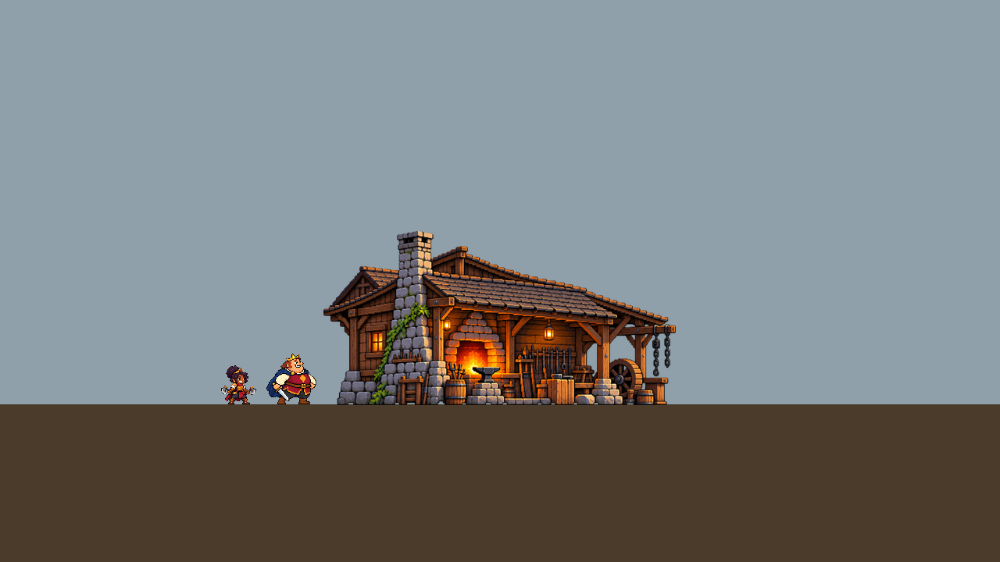
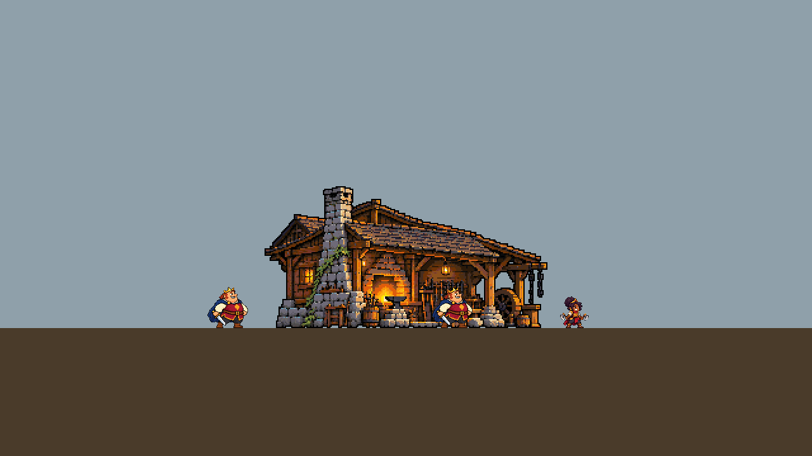

# Forja: cenários e construções — pesquisa, método e piloto (28/10/2026)

> Pedido do dono, a 28/10/2026: *«Chegou o momento de transformar a forja também em uma ferramenta/estrutura pronta
> para desenvolver cenários e construções em um jogo pixel arte, não é só visualmente, mas estruturalmente como os
> jogos de pixel arte elaboram e montam para ser coeso e bem feito, por isso utilize os arquivos que enviei como base,
> quero que aprofunde paralelamente ainda mais essa pesquisa e conhecimentos sobre como fazer isso e como pegar uma
> referencia e adequar ela corretamente para personagens no caso do meu jogo que estão sendo gerados em 64x64 e
> 80x80.»* Com o relatório de 32 páginas *A construção de um mundo em pixel art* (revisão 2) e o pacote para o Claude.
>
> Tarefa: [FORJA-11](../../../backlog/FORJA-11.md). Decisão: [ADR 0098](../../../adr/0098-a-forja-desenha-cenarios-pela-regua-dos-atores.md).
> Guia de uso: [FORJA.md, «Cenários e construções»](../../FORJA.md#cenários-e-construções).

## O que está aqui

| Pasta ou ficheiro | O que é |
| --- | --- |
| [`pacote/`](pacote/) | O pacote do dono: o texto do relatório (o PDF de 24 MB fica fora; sha256 `6389c3f9…`), o handoff, o plano piloto, as fontes v2 (34), os prompts e a inspeção das referências |
| [`referencias/`](referencias/) | As quatro referências do pacote e a Enramados que o dono anexou na conversa (outros pixels: `ea4e2e2d…`, sem grade medida), registadas como `concept` em [`registo.json`](registo.json) |
| [`pesquisa/`](pesquisa/) | As três frentes desta revisão, com fontes legíveis por máquina: [A — escala e adaptação](pesquisa/A-escala-e-adaptacao.md) (48 fontes), [B — estrutura modular](pesquisa/B-estrutura-modular.md) (63), [C — rotas de geração](pesquisa/C-geracao-ambientes.md) (56) |
| [`fontes.json`](fontes.json) | O índice único das fontes das três frentes e do pacote, por URL (185 distintas), com a frente e o id de cada citação |
| [`cenas/`](cenas/) | Os contratos `forja.scene/1` do piloto: a oficina (marco), a forja jogável comprimida, o carvalho e a faixa de terreno dos Enramados |
| [`prova_cenarios.py`](prova_cenarios.py) e [`prova.json`](prova.json) | A prova: mede, compila, planeia sem rede, reduz, revê e monta; falha se uma medida mudar (`make forja`) |
| [`evidencias/`](evidencias/) | As imagens da prova: escala das referências, régua, oficina reduzida, montagem de dia e de noite, Wang 16 |

Convenção herdada das três pesquisas: **facto** (com fonte), **medição** (nossa, reproduzível), **inferência** e
**proposta**. Uma proposta não é decisão (ADR 0079): as que mudam contratos estão em `docs/QUESTIONS.md` (Q-295–Q-300).

## 1. Como adequar uma referência aos atores de 64×64 e 80×80

### 1.1 A régua vem do jogo, não da referência

Os atores do Empire desenham-se a 1 px e o cenário a células de 2 px (Asset Bible §1). Em unidades de cenário o
Empire é um mundo de 640×360 com um rei de ~33 células — a mesma base de Kingdom Two Crowns, Owlboy, Blasphemous e Sea
of Stars (medição A §1), com personagens no dobro da densidade. A régua lê-se dos ficheiros que o jogo usa, nunca de
um número escrito à mão (`forja regua`):

| Grandeza | De onde vem |
| --- | --- |
| Altura e largura visíveis de cada ator | `body_bounds` do manifesto V15 (`art/export/royals/manifest.json`): o Rei é o mais alto, a Nia a mais baixa; a Bailarina fica de fora (galeria) |
| Linha do chão, nível inferior, horizonte | `art/export/scenery_owner/manifest.json` (`surface_y`, `under_y`) e `src/sim/band.gd` |
| Janela | `project.godot` |
| Fase da grade de 2 px | medida nos 191 planos exportados da arte do dono: todos em (0, 0) |

O pé de um ator pinta a fila y=517; a aresta de baixo dele é 518, par: **a linha do chão está na grade da arte que
já existe**, e um edifício cuja última fila é 517 assenta nela sem meio pixel. O horizonte (420) e o fundo do ecrã
(720) também. Só o nível inferior (618,5) cai fora: a aresta 619 é ímpar (Q-296). A régua não arredonda posições da
simulação para caber na grade (relatório §19).

### 1.2 As medidas da arquitetura, sobre a régua

Nenhuma fonte publica uma regra numérica «porta = X × personagem» para pixel art (A §2.3). As razões medem-se: portas
comuns a 1,0–1,2× o ator (Stardew, Terraria; a porta real é 1,16×), portas públicas e monumentais a 1,4–1,9× (Celeste,
Kingdom Olympus, Hyper Light Drifter), e em vista lateral comprime-se o número de vãos e pisos, não a porta (A §2.2).
O sintoma clássico do erro é o ator parecer «uma criança ao lado da porta»; corrige-se a porta, não o ator (A §2.2).

As métricas vivem em [`tools/forja/scenery.json`](../../../../tools/forja/scenery.json) como fatores sobre a régua,
cada uma com a origem; em px de ecrã, a `forja regua` dá hoje (arredondado para dentro da grade de 2 px):

| Métrica | px | células | Fator |
| --- | --- | --- | --- |
| Vão livre de uma porta comum | 72–80 | 36–40 | 1,1–1,24 × o mais alto |
| Porta pública (forja, armazém, portão) | 88–104 | 44–52 | 1,35–1,6 × |
| Beiral de casa térrea | 88–104 | 44–52 | 1,35–1,6 × |
| Cumeeira de edifício pequeno | 120–136 | 60–68 | 1,84–2,1 × |
| Peitoril / altura da janela | 36–44 / 20–28 | 18–22 / 10–14 | 0,55–0,68 / 0,3–0,44 × |
| Guarda, cerca | 32–40 | 16–20 | 0,49–0,62 × |
| Degrau (espelho) | 6–8 | 3–4 | fixo |
| Barril, bigorna | 28–36 | 14–18 | 0,43–0,56 × |
| Lanterna de parede (centro) | 80–88 | 40–44 | 1,23–1,36 × |

Telhado: 2:1 por omissão, em degraus iguais; 1:1 só em colmo, torres e frontões (A §5.1). Tudo isto é proposta até o
dono decidir (Q-295). O edifício pequeno de ~120×130 da Asset Bible cabe nestas medidas sem as forçar.

### 1.3 O método, em quatro números

`forja escala` faz a conta com marcos medidos na referência (`--mark caixa=métrica`):

1. **Escala de cada marco**: o intervalo da métrica sobre a altura medida. O marco do próprio objeto vem primeiro
   (a porta da casa, o barril da oficina); os outros conferem.
2. **Coerência**: as escalas admissíveis dos marcos cruzam-se? Se não, a referência desenhou partes em escalas
   diferentes — vale o marco do objeto e a exceção regista-se no contrato (A §4.2, passo 2).
3. **Pixel aparente** (`r`): o período da grade medida na referência × a escala, contra a célula de 2 px. Acima de
   1,5× a referência é mais grossa e o redesenho **acrescenta** detalhe na grade do jogo; abaixo de 0,75× é mais fina
   e o redesenho **simplifica** (funde, corta, exagera os sinais); sem grade medida, a referência é pictórica e decide
   só a silhueta e os materiais.
4. **Extensão**: o objeto à escala, em px e células, e a fração de um segmento de 640 px (um assunto por segmento,
   Asset Bible §1).

E uma regra que todas as fontes repetem: **não reduzir, redesenhar** (Saint11, A §4.1). A redução só serve para ver.

### 1.4 O que as referências do pacote disseram

| Referência | Marcos | Escala | Pixel aparente | Extensão do objeto | Leitura |
| --- | --- | --- | --- | --- | --- |
| Oficina isolada | barril 107 px | 0,30 (0,26–0,34) | 3,99 → 1,19 px (0,59×) | 452×222 px (0,71 segmento) | **mais fina**: simplificar; alfa parcial (801 535 px) |
| Enramados (pacote) | barril da oficina 59 px; porta da casa 87 px | 0,54 pelo barril; a porta pede 0,83–0,92 | 5,58 → 3,03 px (1,51×) | oficina 472×220 px (0,74) | **escalas misturadas**: a casa vizinha está noutra escala; **mais grossa**: acrescentar detalhe |
| Enramados (conversa) | porta 87 px | 0,87 | sem grade medida | panorama 1460×822 px | **pictórica**: só silhueta e materiais |

Medido pela [prova](prova.json); as bancadas estão em [`evidencias/`](evidencias/). Duas referências independentes,
cada uma pelo seu barril, levam a mesma oficina a ~450–470×220 px: é a extensão do contrato do piloto (448×224). A
porta da casa da Enramados, se mandasse, faria a oficina ter 810 px — mais do que um segmento — e os barris chegariam
ao peito do Rei ([`escala-enramados.png`](evidencias/escala-enramados.png)).



### 1.5 A pegada da simulação manda na planta

A escala diz o tamanho da porta; a **simulação** diz a largura da obra. A forja jogável tem 120 px
(`data/source/buildings.csv`), e as obras de ofício dos povos 80. À escala dos atores, as duas oficinas das
referências têm 450–470 px: são **marcos** de cenário, não a forja do jogo. Para a forja jogável a planta comprime-se a
~0,27 (`forja escala --footprint 120`): fica uma baía, a chaminé, a boca da forja e os apoios, com a porta na régua —
comprimem-se os vãos e os pisos, não a porta (A §5.3). O contrato
[`forja-jogo-enramados.json`](cenas/forja-jogo-enramados.json) descreve essa forja em 128×136 (Q-298).

O caminho errado também está na prova: **encolher** a oficina para 120 px apaga 741 de 1 682 células (44%) e deixa a
baía com 20 px legíveis, contra os 72 que o Rei pede; a revisão estrutural bloqueia
([`oficina-encolhida.png`](evidencias/oficina-encolhida.png)). Redesenhar, não reduzir.

## 2. Estrutura: o que torna um cenário remontável

A pesquisa B (63 fontes) e o relatório do dono convergem em cinco ideias, que a Forja agora sustenta:

1. **Uma construção tem identidade como um rosto.** O contrato `forja.scene/1` nomeia os sinais (inclinação do
   telhado, beiral, chaminé ligada, apoios, base, área de trabalho, copa, tronco, raízes), os vãos que um ator usa e
   os materiais com a sua gramática (relatório §10–§12, §18). O prompt deixa de falar de rosto, roupa e pose.
2. **A grelha só dá massa e colisão; os carimbos dão silhueta.** Tiles limpos por baixo, objetos com origem própria
   por cima (SLYNYRD, Terraria `Origin`/`AnchorBottom`, Dead Cells; B §2). Kits repetem só no eixo declarado e por
   repetição, nunca por esticar (9-slice em `TILE`, B §3.2).
3. **Estados são a mesma peça.** `empty · scaffold · building · done · damaged · ruin` são frames de um ficheiro; o
   que pode mudar em cada estado declara-se por zonas, e o resto confere-se igual (B §3.4; relatório §25).
4. **As emendas provam-se pela topologia.** Os 16 tiles de canto dão 64 pares horizontais e 64 verticais compatíveis
   e 512 blocos 2×2; o contraste médio (`tiles.seams`) não prova nenhum deles (B §1.4).
5. **A prova é uma cena.** A peça isolada engana: monta-se no mundo, na linha do chão, com os atores reais, de dia e
   de noite (relatório §26; Level Design Book, B §5.5).

## 3. O que entrou na Forja

| Peça | O que faz | Responde a |
| --- | --- | --- |
| `regua.py`, `forja regua` | atores, mundo, fase da grade e métricas, lidos dos ficheiros do jogo | relatório §19; pergunta da escala |
| `scene.py`, `forja.scene/1` | o contrato: asset, extensão explícita, projeção, vãos medidos pela régua, sinais, materiais, estados, papéis das referências | §9, §10, §17, §18 |
| `scene_prompt.py` | o prompt de elevação lateral, cada linha com origem; a régua em imagem (silhuetas reais, porta, vãos) | §18, §28; C §7.4 |
| `scene_plan.py`, `forja cena --backend`, `plan/auto --scene` | o plano sem rede para gpt-image, Gemini e PixelLab (nas células); partição em regiões quando excede o modelo | §21, §22; C §7.2–§7.3 |
| `estrutura.py`, `forja estrutura` | extensão, grade, base no chão, vãos (escuros, acesos ou vazados), sinais contra o mestre, repetição, conectores, estados | §23–§26; B §7d |
| `tiles.pairs`, `tiles.junctions` | os 64+64 pares por topologia e os cachos partidos nas emendas e nos 512 cruzamentos | §24; B §1.4 (V1, V2) |
| `montagem.py`, `forja montagem`, `forja escala` | a bancada 1280×720 com os atores reais, dia e noite aproximada; a escala de uma referência por marcos | §26, §29 |
| núcleo | sem tela 64×64 por omissão para casas; `--bg keep` para planos opacos; o contorno dito em pixels lógicos; a tela e o pivô da cena pelo `expect` | handoff, «Primeiras mudanças» |
| PixelLab | o hash da especificação (`ae1f76eb…`): só mudou uma descrição; 63/63 limites conformes ([contrato](../2026-10-26-pixellab-engenharia-reversa/contrato-2026-10-28.json)) | C P-1 |

O que **não** entrou, e porquê: os endpoints novos do PixelLab para ambientes (`create-tileset-sidescroller`,
`generate-image-v2`, `map-objects`, `inpaint-image-pro-flash`) pedem adaptador, testes e uma sondagem paga; a tabela de
pixels do Gemini agora publicada (C P-8); a grade por janelas em cenas largas (C P-6); o lint de retilinearidade de
telhados (C P-7); a família 1D de tiles de superfície (B §7b). Ficam no [FORJA-11](../../../backlog/FORJA-11.md) como
seguimento.

## 4. O piloto

A prova leva a oficina do pacote à escala da régua por **redução declarada** (`forge --reduce --cells 222x110`, com 1
célula de folga de cada lado para o contorno): é uma adaptação com perda, não um mestre. O que a Forja disse dela:

- grade `deliberately_reduced`; 2 352 células apagadas pela amostragem e 33% de células misturadas — o detalhe da
  referência é mais fino do que a célula, como a escala previa;
- estrutura: extensão 448×224, grade, base no chão, a baía com 118 px livres até à soleira (o Rei passa; 119 antes da correção da altura, FORJA-12), a janela
  acesa legível;
- sinais presentes mas `inconclusive`: sem mestre aprovado não há contra o que comparar a forma;
- aprovação `pending`.



De noite (só a modulação da fase, sem as luzes da §80), o Rei diante da baía escura perde separação
([`montagem-oficina-noite.png`](evidencias/montagem-oficina-noite.png)): é o argumento para a camada emissiva própria
da forja (B §5.4) e para rever a baía na captura do motor.

Os quatro contratos do piloto planeiam-se sem erros no gpt-image e no Gemini (prova §4). O PixelLab recusa-os: as
referências deles (composição, material, o conceito em alta resolução) não têm entrada no `create-image` ou não estão
no tamanho do pedido, e antes da auditoria de 28/10 ficavam escritas no plano sem chegar ao modelo (FORJA-12, A5).
Os estados e as condições que declaram ainda não dizem onde mudam (`state_changes`): o contrato avisa. O pedido da oficina está em
[`oficina-prompt.txt`](evidencias/oficina-prompt.txt) com a [régua em imagem](evidencias/oficina-regua.png). Não houve
geração paga: o passo seguinte é gerar, forjar com o `expect.json` e rever com `estrutura` e `montagem`.

## 5. Limites

- Nada aqui é arte aprovada. As referências são `concept`; a oficina reduzida é uma prova de método.
- As métricas de arquitetura são propostas derivadas de medições e de métricas reais/3D, não regras publicadas.
- A noite da bancada não é a do motor; a fase da grade é a do PNG, não a do ecrã com a câmara a mexer (A §3.4).
- Três tamanhos de célula (1/2/4 px) excedem a regra «no máximo duas resoluções» do Saint11; ficam defensáveis com
  uma célula por plano, nada misturado dentro de um objeto e o plano de 4 px de contraste baixo (A §3.3).
- Fontes que não abriram (Kingdom no TIGSource, Spriters Resource, Behance de Maarten Boot): ver A §7 e B §8.

## Reproduzir

```bash
python3 docs/art/research/2026-10-28-forja-cenarios/prova_cenarios.py     # ~1 min; reescreve prova.json e evidencias/
python3 -m tools.forja regua
python3 -m tools.forja escala docs/art/research/2026-10-28-forja-cenarios/referencias/oficina-referencia.png \
  --mark 538,780,628,887=barrel_height --ground-y 888 -o build/forja/escala-oficina
python3 -m tools.forja cena docs/art/research/2026-10-28-forja-cenarios/cenas/oficina-enramados.json -o build/forja/oficina
```
