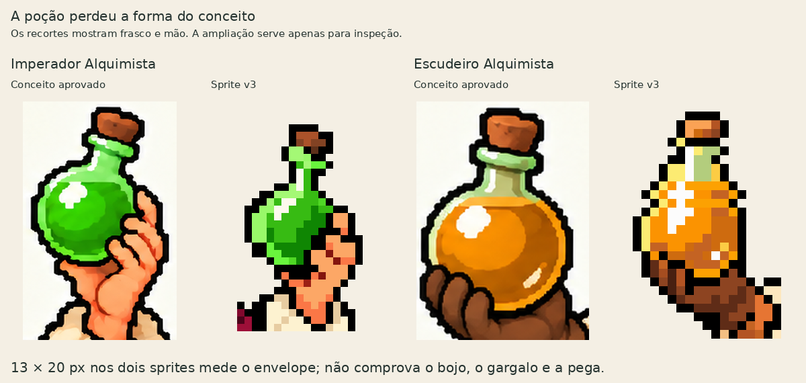
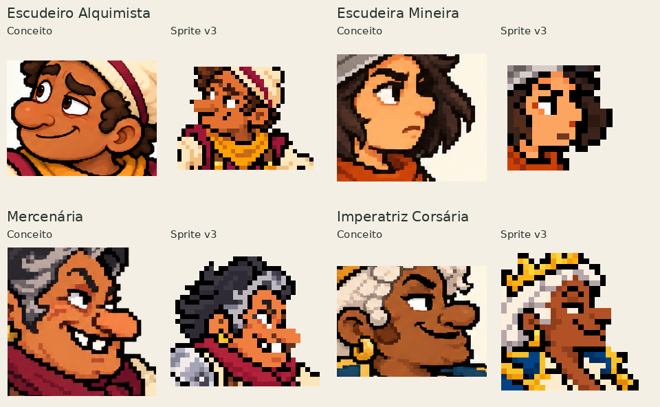
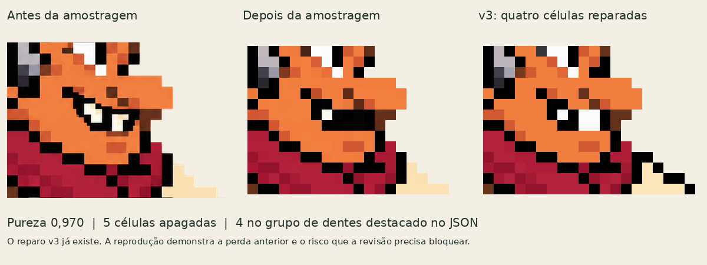
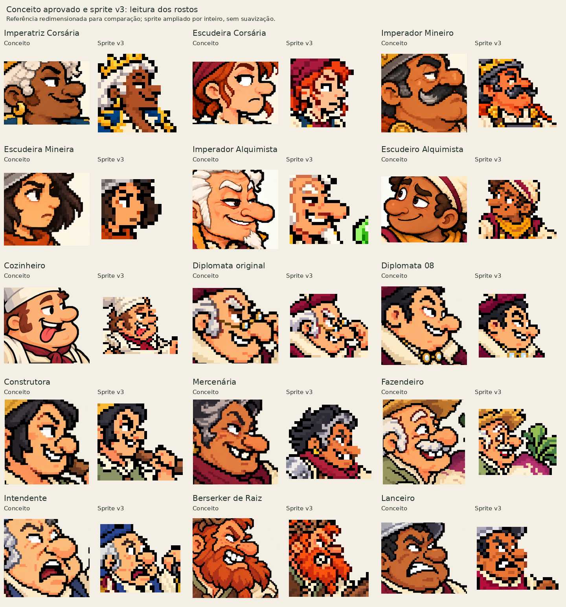

# Forja: auditoria de fidelidade de objetos e expressões

EMPIRE | 29/10/2026 | análise do pacote de 15 sprites v3 e do código local da Forja

## Parecer

**A reclamação procede. O resultado ainda perde características importantes dos conceitos aprovados. Há perdas reproduzíveis na conversão e lacunas na validação, somadas a decisões inadequadas de seleção e acabamento. Não é correto atribuir tudo à Forja, nem apresentar seus passes técnicos como prova de fidelidade.**

Na revisão anterior, o agente protegeu equipamentos que já estavam simplificados e descreveu ajustes de expressão como recuperação da personalidade. Preservar os pixels de uma adaptação ruim conserva o problema. A ferramenta já separa identidade e aprovação dos testes técnicos; essa distinção não orientou suficientemente a entrega.

Este documento entrega diagnóstico, evidências e propostas de implementação. As correções propostas ainda não foram implementadas. O feedback atual reprova a qualidade do lote; isso não significa que Henrique tenha indicado individualmente cada arquivo ou revogado os conceitos aprovados.

## 1. Escopo e método

- Inspeção visual dos 15 sprites e de seus conceitos, com foco em frascos, nariz, olhar, sobrancelhas, boca, dentes e expressão.
- Leitura dos relatórios, contratos, máscaras, patches, fontes geradas e histórico v2/v3.
- Reprodução da amostragem da mercenária com o código local, sem nova geração.
- Mutação controlada em memória do contrato do escudeiro alquimista, seguida da validação real da Forja.
- Consulta de documentação oficial e pesquisa primária sobre abstração em pixel art.

As contagens de estados abaixo foram lidas do pacote; não representam uma nova execução da suíte completa. A reprodução de amostragem e o teste de mutação foram executados nesta auditoria. Não houve teste na engine, abertura no Aseprite, geração de sprites ou alteração do código da Forja. Os arquivos auditados permanecem intactos.

O snapshot do código examinado está identificado por caminho e SHA-256 em `evidencias/codigo-conferido.json`. O estado atual da main remota não foi reconfirmado. Os scripts de diagnóstico têm menos de 250 linhas cada.

## 2. Resultados verificáveis

| Medida | Resultado | O que demonstra |
|---|---:|---|
| Personagens examinados | 15 | O escopo inclui todo o elenco do pacote |
| Estado técnico `runtime=pass` | 15 | Os relatórios consideram os arquivos tecnicamente válidos |
| Preservação de sinais declarados em `pass` | 15 | Os sinais fornecidos à etapa final sobreviveram a ela |
| `deliverable=true` na revisão completa | 0 | Identidade e aprovação do mestre continuam pendentes |
| PNGs mantidos integralmente da v2 | 7 | Esses sete não receberam nova correção na v3 |
| Exportações finais com `erased_cells=0` | 15 | A etapa final, sobre bases já nativas, não mede as perdas anteriores |
| Mercenária: pureza / células apagadas na recuperação | 0,970 / 5 | Pureza alta pode coexistir com perda relevante |
| Células dos dentes apagadas reproduzidas | 4 | Há perda concreta de um sinal facial |
| Frascos: envelope comum | 13 × 20 px | Igualdade de dimensões externas, sem prova de forma |

Zero entregáveis não significa que os 15 desenhos tenham o mesmo defeito: significa que nenhum possui os quatro estados de entrega em pass. Da mesma forma, centenas de pinos verificados não equivalem a centenas de características artísticas preservadas.

## 3. Caso A: a poção deixou de parecer a poção aprovada



**Observação visual:** o conceito apresenta um bojo arredondado, ombros definidos, gargalo curto com aro, rolha destacada e reflexos que explicam vidro e líquido. No sprite, sobretudo no frasco verde, a leitura fica alongada e mais pontuda; aro, transição entre gargalo e bojo e contato dos dedos ficam simplificados. O frasco âmbar também perde a proporção do bojo do conceito. Continuam sendo reconhecíveis como recipientes, mas não preservam bem o modelo aprovado.

**Medição:** as máscaras anotadas dos dois frascos têm envelope 13 × 20 px e 162/168 pixels visíveis. Os perfis de largura por linha são diferentes. A interseção sobre união das máscaras visíveis normalizadas é 0,728; com espelhamento, 0,626. Esses números não são notas de qualidade: mãos, orientação e oclusão diferem. Servem para mostrar que o teste anterior de tamanho não era um teste de mesmo molde.

**Rastreio:** o script `patch_cast_v2.py`, linhas 66-76, move o gargalo e estende a parte superior da poção âmbar para obter o envelope do imperador. A v3 conserva exatamente os pixels dos dois frascos da v2. Logo, a revisão de personalidade não corrigiu os objetos. O desenho gerado, a recuperação da grade e esse ajuste local precisam ser comparados separadamente; não é possível atribuir toda a deformação da poção apenas à amostragem.

**Lacuna de código comprovada:** `shared_prop_constraints` descreve o mesmo molde e tamanho absoluto, mas não há leitura desse campo em `tools/forja/`. `production.validate()` também não o valida. No teste em memória, definir `native_shared_dimensions=[99,3]` devolveu a mesma lista vazia de erros do contrato original. Isso demonstra ausência de validação da restrição; não significa que a Forja tenha medido um frasco 99 × 3 e o aprovado.

Além disso, `equipment.FAMILIES` contém espada reta, arco, escudo e bolsa, mas não frasco/recipiente com bojo, gargalo, aro e rolha. A geometria genérica de partes e contatos já existente pode ser estendida para esse caso, sem inventar mecânicas de jogo.

**Melhoria necessária:** definir primeiro um modelo nativo do frasco a partir do conceito. Guardar contorno, bojo, gargalo, aro, rolha, vidro/líquido, brilho e máscara da mão em componentes separados. Os dois personagens compartilham a geometria do recipiente na mesma escala de mundo; cor do líquido, orientação e oclusão têm regras próprias. Não adotar os 13 × 20 atuais como novo padrão aprovado por conveniência.

## 4. Caso B: a personalidade foi reduzida a marcas genéricas



**Observação visual:** a direção do olhar não basta para reproduzir uma expressão. Na corsária, o conjunto de pálpebra, sobrancelha e canto do sorriso fica menos legível. Na escudeira mineira, olho, sobrancelha e boca perdem a tensão cética. No escudeiro alquimista, o nariz fica mais reto e projetado, e o sorriso e as sobrancelhas perdem a combinação do conceito. Na mercenária, recolocar dentes não resolve por si só a curva, os cantos e a relação da boca com o nariz.

A recuperação da escudeira mineira tem pureza 0,984 e zero células apagadas. Ainda assim, o resultado visual não equivale ao conceito. Isso é um contraexemplo importante: uma imagem pode chegar com a atuação já simplificada e ser recuperada sem novas perdas detectadas. O teste mede recuperação de cores; não entende personalidade.

Os contratos têm caixas críticas de rosto, mas não um mapa específico de pálpebra, pupila, sobrancelha, nariz, cantos da boca e dentes. Os pinos usados na etapa final foram extraídos da própria adaptação. Eles ajudam a impedir uma nova alteração; não demonstram que essa adaptação era fiel ao conceito.

Algumas caixas faciais também são apertadas para as projeções do nariz e da boca. Na prancha desta auditoria, os recortes nativos foram ampliados em margem para evitar ocultar traços fora das caixas antigas. A caixa crítica precisa ser revisada quando o desenho muda; não deve ser herdada automaticamente.

**Melhoria necessária:** registrar uma ficha facial específica por personagem, com recorte de autoridade, intenção da expressão, marcos e relações que a tornam reconhecível. Reservar esses sinais na grade nativa e revisar seu conjunto. Narizes grandes, assimetria, dentes irregulares e olhares semicerrados são escolhas aprovadas, não ruído a limpar ou desvios a normalizar.

## 5. Caso C: quatro células de dentes desaparecem com pureza de 97%



O script `scripts/auditar.py` reexecuta `gridcheck.measure()` e `pipeline.snap()` sobre a imagem gerada arquivada da mercenária. Resultado reproduzido: grade de 64 × 64, pureza 0,970 e cinco células apagadas. Quatro pertencem ao grupo de dentes:

| Célula na grade de origem | Cor perdida | Cor escolhida | Fração perdida da célula |
|---|---|---|---:|
| (38,23) | #FFFFED | #000000 | 26,6% |
| (39,23) | #FFF6D1 | #050403 | 52,6% |
| (38,24) | #FFFFFF | #040403 | 52,6% |
| (39,24) | #FFFFFF | #050504 | 50,0% |

A pureza considera o miolo das células e sua proximidade à cor escolhida. `resample.py` usa votação/grupos de cores; `loss.py` compara também a célula completa e já registra a perda. Não é um detector semântico de dentes.

**Precisão sobre o estado atual:** as quatro células foram reparadas na v3. A figura e o JSON mostram essa correção; esta auditoria não afirma que continuem apagadas no PNG final. O caso demonstra que a conversão pode destruir atuação, que o alerta já existia e que o reparo local não comprova fidelidade da expressão inteira.

`limits.losses()` emite `erased` como aviso. `signals.regions()` pode bloquear uma perda em região obrigatória quando recebe a evidência correta. A melhoria não é transformar qualquer perda em erro: é manter a evidência ao longo da cadeia e exigir decisão sobre perdas nos sinais relevantes. Um pixel de ruído não tem a mesma função de um dente ou pupila.

## 6. Caso D: a etapa final parece limpa porque começa depois da perda

Os 15 relatórios finais registram `erased_cells=0`. A entrada dessa etapa é uma base já nativa, como `native-base.png`, e `resample.resample()` possui um caminho direto para uma célula por pixel. Portanto, esse zero pode ser tecnicamente correto **para a última etapa**, enquanto a recuperação anterior apagou detalhes.

Os JSONs anteriores foram incluídos como arquivos separados, mas não há um encadeamento automático de perdas pendentes até a exportação. A proveniência padrão registra uma entrada, sem um grafo de ancestrais e decisões sobre cada perda. A seleção e os scripts de montagem tiveram de manter essa relação por conta própria.

Há ainda dois campos que podem confundir integrações: `pipeline.forge().delivery.usable_sprite` deriva do lint técnico, enquanto `review_state.review().deliverable` exige os quatro estados. Neste lote, o primeiro é verdadeiro e o segundo falso em todos os personagens. O estado textual continua `candidate_in_review`, mas um consumidor que leia apenas `usable_sprite` pode publicar o candidato cedo demais. A auditoria não demonstrou publicação automática por esse campo.

**Melhoria necessária:** separar explicitamente `raster_valid` de `release_ready`, preservar o vínculo entre fonte gerada, recuperação, organização de cor, patch e exportação, e transportar perdas relevantes até sua resolução documentada. Proteger uma base candidata deve indicar o escopo “preservada nesta etapa”, sem promovê-la a mestre ou apagar falhas herdadas.

## 7. Responsabilidade por etapa

| Etapa | Evidência | Responsabilidade / limite |
|---|---|---|
| Referência e geração | Fontes já apresentam simplificações e mudanças de proporção | O agente deve recusar uma atuação que não corresponda ao conceito |
| Recuperação da grade | Dentes apagados reproduzidos | Limitação do voto por célula; a Forja já detecta parte das perdas |
| Ajuste do frasco | Gargalo deslocado para igualar o envelope | Decisão de acabamento que precisa validar forma e pega, além do tamanho |
| Proteção e patches v3 | Corpo e equipamentos conservados fora das máscaras | Proteção correta preserva também defeitos da base escolhida |
| Sinais e contratos | Restrições de frasco sem consumidor; pinos da própria adaptação | Lacunas de validação e de ligação com a autoridade |
| Revisão e apresentação | “Personalidade recuperada” apesar de identidade pendente | Falha do agente: descreveu melhoria local como fidelidade concluída |

## 8. Melhorias priorizadas para implementação

### P0-01. Fechamento único de entrega e continuidade das perdas

- Alvos: `pipeline.py:237-242`, `review_state.py:75-93`, `provenance.py:29-48`, scripts de seleção/exportação.
- Acrescentar um manifesto de etapas com hashes de entrada/saída, transformação de coordenadas, regiões editadas e perdas herdadas.
- Resolver cada perda crítica com prova de reparo, exceção autorizada ou revisão inconclusiva. Um arquivo intermediário novo não encerra a ocorrência.
- Fazer o fechamento consultar runtime, sinais, identidade/pose e aprovação do mestre. Manter a criação de candidatos disponível; o portão impede chamá-los de finalizados.
- Aceite: reexportar uma base nativa após perda crítica continua sem condição de entrega até haver resolução; um reparo comprovado libera somente aquela ocorrência.

### P0-02. Validar o objeto compartilhado e a pega

- Alvos: `production.py:40-66`, `equipment.py:27-39`, `geometry.py`, catálogo e contratos dos alquimistas.
- Implementar consumidor real de `shared_prop_constraints`, com validação de esquema, referência ao par e medida observada nas duas imagens.
- Ampliar o sistema de equipamento para frasco: bojo, gargalo, aro, rolha, vidro/líquido e contatos com a mão, com oclusões explícitas.
- Comparar os dois com um modelo nativo autorado a partir do conceito, preservando escala absoluta e permitindo apenas variações declaradas.
- Aceite: deformar o bojo dentro de uma caixa 13 × 20 deve ser detectado; cor do líquido ou oclusão permitida não deve causar reprovação automática. Sem observação, ficar pendente.

### P0-03. Conferência facial vinculada ao conceito

- Alvos: `fidelity.py`, `visual_review.py`, `signals.py`, contratos do elenco e ferramenta de revisão.
- Registrar olhar/pálpebra, sobrancelhas, nariz, cantos da boca, dentes e pelos faciais relevantes por personagem, com máscara ou marco, intenção e evidência.
- Distinguir sinais “herdados da autoridade” de pinos “proteger este candidato”. Uma fonte não substitui a outra.
- Usar relações e agrupamentos de pixels, além de cores isoladas. A máquina sinaliza; a revisão visual decide o que não é determinístico.
- Aceite: trocar sorriso torto por linha neutra ou mover uma pupila não pode continuar com “personalidade preservada” por causa do hash de exportação.

### P1-01. Recuperação local sensível a detalhes e à confiança da grade

- Alvos: `resample.py:51-109`, `loss.py`, `gridcheck.py` e relatório de comparação.
- Mostrar cada célula crítica antes/depois, votos alternativos, perda detectada e confiança. Não escolher automaticamente toda minoria clara como dente.
- Se a fase/grade for incerta ou houver traços menores que a célula, pedir redesenho nativo da região ou marcação explícita, mantendo corpo e equipamento fora da edição.
- Exemplo de atenção: a recuperação arquivada do escudeiro alquimista estimou 65 × 65, confiança 0,565. Isso recomenda investigação da grade; não prova, por si só, que a estimativa seja errada.
- Aceite: ampliação inteira de pixel art conhecida volta exatamente ao original; traço subpixel fica inconclusivo ou requer decisão, sem redução forçada para caber.

### P1-02. Revisão em componentes e prova antes do lote

- Alvos: fluxo de produção, ferramenta de comparação, exportação Aseprite e script de pacote.
- Resolver primeiro a dupla dos alquimistas: modelo de frasco, pega e rosto. Confrontar conceito, fonte recebida, recuperação e PNG final a 1× e em ampliação inteira.
- Só depois aplicar o método ao elenco completo; manter no relatório os 15 e o estado individual, inclusive os sete não alterados na v3.
- Separar componentes de autoria conforme o contrato do projeto; não prometer que as duas camadas atuais já individualizam mãos e objetos.
- Aceite: uma peça com rosto ou acessório pendente pode ser exportada como estudo, mas não pode receber um rótulo de mestre concluído.

### P2-01. Remover instruções genéricas conflitantes e criar benchmark

- Alvos: `EXPRESSION_GUIDE.md`, autoridade de referências e conjunto de casos de regressão.
- O guia histórico contém Horta vegetal e proibição genérica de assimetria em repouso, em conflito com decisões posteriores e personagens aprovados. Atualizar a precedência e sinalizar esses trechos como superados. Não foi provado que tenham vazado no prompt desta entrega.
- Criar benchmark com os conceitos reais do elenco, exemplos bons revisados e mutações controladas. Avaliar o método por personagem, sem transformar o próprio candidato em gabarito.
- Aceite: o conceito escolhido prevalece; nenhuma regra genérica muda nariz, humanidade, assimetria, acessório ou expressão aceita.

## 9. Testes de regressão propostos

Estes são critérios para a implementação futura, não testes já aprovados de uma correção inexistente.

| Caso | Mutação / entrada | Resultado esperado |
|---|---|---|
| T01 - objeto, mesmo envelope | Afinar bojo e alongar gargalo, mantendo largura/altura totais | Divergência de forma; nunca apenas pass pelo tamanho |
| T02 - restrição compartilhada | Dimensão declarada incompatível, par inexistente ou dado inválido | Erro de esquema ou bloqueio com evidência observada |
| T03 - variação permitida | Mudar verde para âmbar mantendo molde | Permitido quando declarado, sem exigir igualdade de cores |
| T04 - pega e oclusão | Mão flutuante versus mão cobrindo parte do vidro | Falhar contato ausente; ocluído fica inconclusivo onde não há prova |
| T05 - olhar | Deslocar pupila preservando tamanho, paleta e contorno | Revisão facial sinaliza mudança de atuação |
| T06 - boca | Trocar sorriso assimétrico por linha neutra | Não declarar personalidade preservada |
| T07 - dentes | Usar a fonte da mercenária deste pacote | A perda é registrada e transportada; reparo vinculado ao sinal |
| T08 - reexportação | Exportar base nativa depois de perda crítica não resolvida | Zero perdas locais não encerra a ocorrência anterior |
| T09 - recuperação exata | Ampliar um mestre conhecido por inteiro e recuperar | Igualdade RGBA, posição, contorno e sinais |
| T10 - pinos do candidato | Criar pinos depois de simplificar a face | Garante proteção local; não preenche fidelidade ao conceito |
| T11 - edição local | Corrigir rosto ou frasco em máscara autorizada | Exterior, pivô e componentes fora da máscara idênticos |
| T12 - fechamento | Raster válido com identidade pendente / hash rejeitado | Candidato exportável para estudo; entrega final bloqueada |
| T13 - elenco completo | Executar o relatório de lote | 15 entradas com estados separados; sem omitir os não corrigidos |

Evitar testes que só conferem se o JSON contém a descrição desejada. Os testes precisam alterar a imagem ou a evidência de origem e verificar se o resultado muda corretamente. A revisão artística continua sendo explícita e baseada no PNG final, mesmo após testes automáticos.

## 10. Triagem visual de todo o elenco

As observações abaixo são desta auditoria. Henrique não nomeou individualmente esses defeitos. Todos continuam sujeitos à comparação completa com a autoridade; a prioridade não constitui aprovação dos demais.

| Personagem | Próxima revisão necessária |
|---|---|
| Imperatriz Corsária | Pálpebra, sobrancelha e canto do sorriso; recuperar confiança sem neutralizar o rosto |
| Escudeira Corsária | Olhar lateral e boca contrariada; a v3 manteve a v2 sem corrigir esses sinais |
| Imperador Mineiro | Olhar convencido, desenho do bigode e separação de boca/queixo |
| Escudeira Mineira | Expressão cética como conjunto; zero perdas detectadas não resolve a simplificação |
| Imperador Alquimista | Modelo do frasco e pega; preservar identidade asiática e nariz original ao rever o rosto |
| Escudeiro Alquimista | Bojo/gargalo/rolha e mão; nariz arredondado, sobrancelhas diferentes e meio sorriso |
| Cozinheiro | Relação entre olho, sorriso, dentes e língua; revisar o rosto inteiro junto ao barrete |
| Diplomata original | Olhos e lentes no nariz, sorriso e mão que ajusta os óculos; evitar fundir lentes e pele |
| Diplomata 08 | Sorriso e olhar próprios; conservar os dois óculos azuis no peito |
| Construtora | Sorriso e sobrancelha sem transformar os dentes em barra genérica; conferir mão/malho |
| Mercenária | Curva e cantos do sorriso, espaços entre dentes, olhar e nariz; não limitar a correção aos quatro pixels |
| Fazendeiro | Alegria do rosto humano idoso, bigode e separação do nabo/mãos; preservar humanidade |
| Intendente | Olhar preocupado e boca aberta; revisar também livro, três chaves e seus contatos |
| Berserker de Raiz | Sobrancelha raivosa e dentes separados dentro da barba; conservar o personagem humano |
| Lanceiro | Sobrancelhas e careta cerrada; manter diferença entre dentes, boca e planos do queixo |



## 11. Pesquisa externa aplicada

**[S1] Gerstner et al., Pixelated Image Abstraction, NPAR 2012.** A pesquisa mostra que redução e quantização ingênuas perdem informações e que olhos e boca precisam de escolhas de abstração para sobreviver em baixa resolução. Os autores também reconhecem a diferença entre resultados automáticos e escolhas de artistas. Aplicação proposta: reservar sinais faciais importantes e comparar sua organização, em vez de confiar em pureza média. Isso não prova que implementar o algoritmo do artigo resolveria estes sprites.

https://www.cs.columbia.edu/cg/pdfs/197-pixelated_image_abstraction.pdf

**[S2] Pillow, documentação oficial de filtros.** NEAREST seleciona um pixel e ignora os demais; os filtros são operações de reamostragem. Aplicação: ampliação inteira serve à inspeção; reduzir uma referência não produz automaticamente uma interpretação fiel do rosto. A Forja usa sua própria amostragem por células, analisada no código local, e não deve ser confundida com um simples resize do Pillow.

https://pillow.readthedocs.io/en/stable/handbook/concepts.html#filters

**[S3] Aseprite, API SpriteSize.** A documentação distingue os métodos nearest, bilinear e rotSprite; nearest é o padrão desse comando. Aplicação: fixar explicitamente o método da prévia e revisar o raster transformado. Nenhum desses nomes é um selo de qualidade artística.

https://www.aseprite.org/api/command/SpriteSize

**[S4] PixelLab, documentação oficial de edição por referência.** O fluxo oferece edição orientada por texto ou referência, com tamanho de saída selecionável. Aplicação proposta: experimentar uma rota nativa por referência em um benchmark controlado, caso já esteja disponível e autorizada, comparando resultados reais antes de adotá-la. Não houve execução de PixelLab nesta auditoria, nem prova de superioridade para o elenco.

https://www.pixellab.ai/docs/tools/edit-image-pro

**[S5] PixelLab, Image to pixel art.** A página documenta redução e redimensionamento interno nessa ferramenta. Aplicação: conferir o caminho real da imagem e a grade recebida; usar um serviço com nome “pixel art” não dispensa auditoria da resolução e dos detalhes.

https://www.pixellab.ai/docs/tools/image-to-pixel-art

Fontes consultadas em 29/10/2026. Os diagnósticos específicos do EMPIRE derivam das imagens e das reproduções locais, não das alegações comerciais dos serviços.

## 12. Arquivos e reprodução

- `evidencias/resumo.json`: contagens e resultados reproduzidos.
- `evidencias/elenco.json`: hashes, telas, estados e perdas por personagem.
- `evidencias/frascos.json`: medidas, perfis e limitações da comparação das máscaras.
- `evidencias/teste-restricao-compartilhada.json`: resultado da mutação do campo atualmente sem validação.
- `evidencias/casos/`: fonte da mercenária, recuperação, grade, dentes e snapshots dos casos principais.
- `evidencias/01-...06-...png`: comparações visuais feitas com os arquivos reais.
- `fontes/`: snapshot dos módulos da Forja usados como evidência, sem modificações.
- `scripts/auditar.py`: diagnóstico do comportamento atual. Asserções registram o defeito existente e precisam ser convertidas em expectativas de correção quando a ferramenta mudar.
- `scripts/pranchas.py`: recria comparações a partir do pacote v3 local; não redesenha assets.
- `scripts/reproduzir_casos.py`: usa somente as evidências deste pacote e o repositório para repetir a perda dos dentes e a ausência de validação em `production.validate`.

Para repetir a auditoria com o pacote v2/v3 original disponível ao lado do repositório:

```bash
python3 scripts/auditar.py --package /caminho/EMPIRE-Sprites-15-v3 --repo /caminho/empire
```

O script lê também o diretório irmão `EMPIRE-Sprites-15-v2` para conferir os sete PNGs inalterados. As cópias de contratos em `casos/` são snapshots para leitura e não um pacote de produção com todas as referências relativas. Para uma reprodução mínima da conversão, basta importar a Forja do repositório, abrir `casos/mercenary-source.png`, medir a grade e executar snap; a grade e a saída originais estão arquivadas ao lado.

Sem os pacotes anteriores, executar `python3 scripts/reproduzir_casos.py --repo /caminho/empire`. O script confere os hashes do código auditado e distingue o teste mínimo de esquema da validação completa feita na auditoria.

**Ordem recomendada:** implementar P0-01/P0-02/P0-03; provar o método na dupla dos alquimistas; revisar os 15 personagens com os critérios corrigidos; concluir a revisão artística do PNG efetivamente exportado antes de chamar o lote de finalizado.
