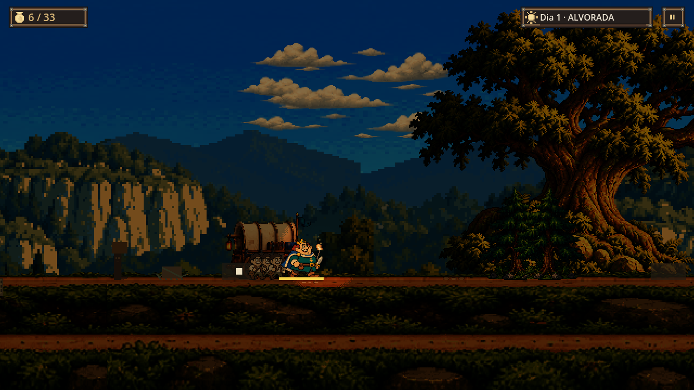
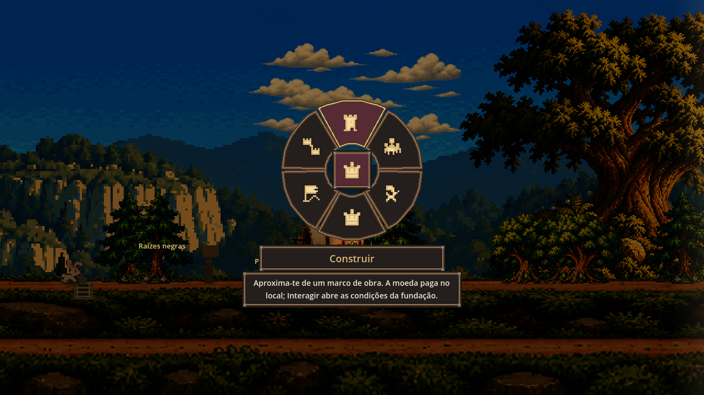
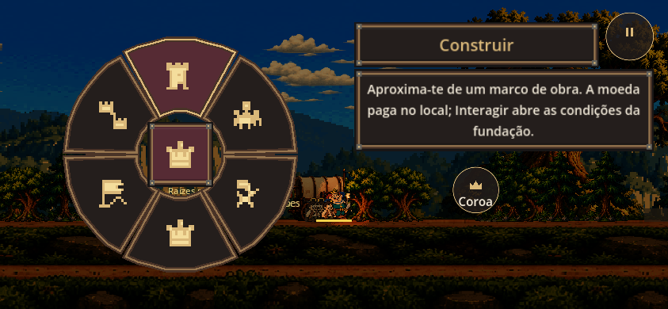
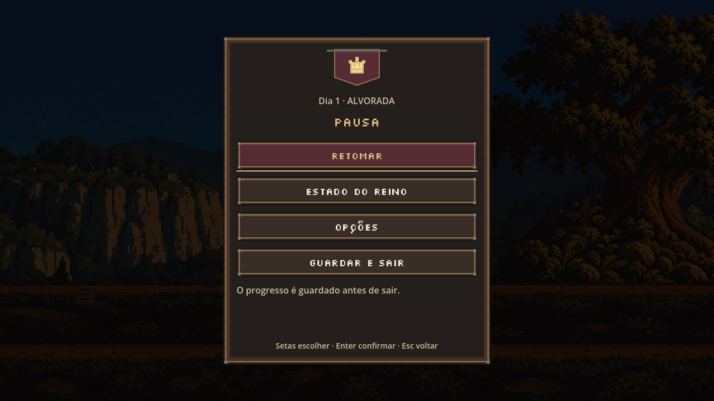
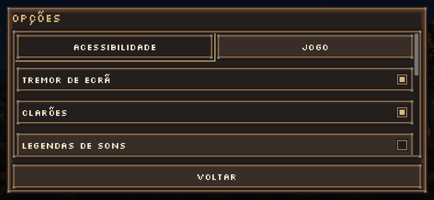

# Oficina da Coroa — implementação no Godot

Pedido aprovado em 18/10/2026; integração e revisão em 20/10/2026. UX-11 e ADR 0090.
As imagens desta página são capturas do jogo no Godot 4.7.2, com o cenário real.

## Exploração

Bolsa/capacidade à esquerda; dia/fase e pausa à direita. Não há painel de objetivos,
logótipo ou barra de gestão permanente. Contexto e instruções conservam HintCue:
só aparecem depois de parar, durante a leitura, e recolhem ao andar. Estação e
informação detalhada continuam acessíveis em Estado do reino. O combate mantém os
comandos; no toque, o botão de ataque mostra as flechas disponíveis. O painel surge para corpos de classe ou durante a recarga do monarca.

## Roda aberta a pedido

Manter Tab, Y ou Coroa no toque abre as seis famílias com posições estáveis.
Apontar e largar escolhe; o centro cancela. Teclado: 1–6 escolhe a família;
Impulsos abre outra escolha, onde 1–6 apresenta o preço e Enter confirma. Esc fecha.
F3 conserva o inspetor separado. A roda usa o abrandamento configurável existente.

Construção, recrutamento e ofícios apresentam as instruções e custos locais do
jogo; não criam nem pagam objetos à distância. Fundação, expedição e sucessão abrem
as ações existentes quando o monarca está no local apropriado. Falta de moedas ou
indisponibilidade de um impulso é explicada e não envia uma intenção inválida.

No telefone, a roda e a explicação ficam lado a lado. Durante este estado os
controlos de movimento/combate ficam recolhidos; Coroa e Pausa permanecem. Ao fechar,
os controlos normais regressam. Perda de foco ou pausa cancela a seleção.

## Pausa

Retomar, Estado do reino, Opções e Sair ocupam o menu principal. Controlos, ecrã
inteiro, reinício, exportação e galeria de animações estão nas Opções.
O foco inicial é Retomar; reiniciar
continua a exigir confirmação com Cancelar selecionado. A política de guardar/sair
é a existente. Uma página substitui a anterior e mantém a simulação pausada.

## Produção e verificação

- CrownSkin gera molduras modulares; CrownIcons usa matrizes nativas pequenas.
  Madeira, ferro, latão e tecido bordô partilham uma paleta. Filtro nearest nos
  elementos gráficos; fonte pixel existente nos botões e leitura escalável no corpo.
- Não há mudança na resolução do mundo, nos sprites, nos preços ou nos saves.
- Testes: crown_hud, royal_wheel, immersive_hints, hud_layout, hud_copy, atlas,
  pause_navigation e touch_input_lifecycle. Os testes de roda, toque e navegação
  também foram executados com o servidor gráfico e renderer ativos.
- Capturas em 1280×720 e 844×390; exportação web real concluída. A suíte integral e
  os portões do repositório são requisitos para integrar. A publicação deve ser
  verificada pelo commit servido em /versao.json e pelo fumo de produção.
- As capturas pequenas são simulações de viewport, não ensaios num telefone físico.
  Os conceitos gerados anteriormente orientam o aspeto; não são usados como provas.

## Retoma da integração — 23–24/10/2026

A implementação foi recuperada no ramo `codex/oficina-coroa-runtime-20261020`,
no commit `01b3808`. A integração com a `main` em `cbc8366` preserva o elenco
V15, a galeria, o portão de publicação e os reparos da Forja. A decisão desta HUD
passa a ADR 0090: a ADR 0087 identifica o elenco V15 e as ADR 0088 e 0089
identificam a Forja e os seus reparos.

A galeria acrescentada na `main` fica nas Opções. Um teste reproduziu a quinta
entrada indevida na pausa; depois da correção, as quatro entradas aprovadas e
o regresso da galeria às Opções, com foco reposto e simulação pausada, passam.

As imagens acima documentam a implementação de 20/10, anterior ao elenco V15.
O workflow `ci` passa a executar as regressões de roda, pausa e ciclo de toque
com renderer e a guardar cinco capturas atuais, com manifesto, em
`captura-da-noite/build/oficina`. O SHA da execução identifica a versão testada.
O ambiente local desta retoma não conseguiu abrir os sockets do X11; por isso
não se apresenta uma captura antiga como prova visual da integração atual.

O [CI completo da implementação](https://github.com/henriquecoding/empire/actions/runs/39973328654)
passou no commit `92a3896`. As cinco capturas atuais foram conferidas em 23/10.
A integração de 24/10 só resolve documentação e contagens; não muda o código
da HUD. O [PR #119](https://github.com/henriquecoding/empire/pull/119) acompanha
a nova validação e a publicação autorizada pelo dono em 24/10.
